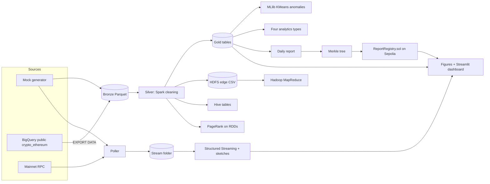

# EtherLens — Big Data Analytics on Ethereum with Verifiable On-Chain Reports

**Build specification for Claude Code.** This document is the single source of truth for building the project end to end: from a synthetic (mock) dataset on a laptop, to a Hadoop/Spark/Hive pipeline on Google Cloud Dataproc over 100M+ real Ethereum transactions, to a live streaming layer, to a Solidity contract on the Sepolia testnet that makes every daily report tamper-evident.

Courses served by this one codebase:

- **CS404 Big Data Analytics** — Hadoop/HDFS/YARN, MapReduce, Hive, Spark (RDDs, SQL, MLlib, Structured Streaming), stream-mining algorithms.
- **Blockchain Technologies** — Ethereum data model, hashing, Merkle trees, gas, accounts/nonces, Solidity smart contracts.

---

# PART A — FOUNDATIONS

## 0. How to use this document

### For the human

One-time installs on Windows: **Docker Desktop** (keep it running), **Git for Windows** (recommended — lets Claude Code use bash), and **Claude Code**.

Then, every time:

1. Make a folder (e.g. `C:\etherlens`) and put this file in it as `PROJECT_SPEC.md`.
2. Open the folder in VS Code, open the terminal, run `claude`, and say:
   > Read PROJECT_SPEC.md completely. Then execute Phase 0. Stop at every 🛑 CHECKPOINT and wait for me.
3. After each phase, say "Continue with Phase N".

That's all. Claude Code runs normally on Windows; it builds a Docker image and runs every heavy tool (Spark, Hadoop tools, Java, Foundry, gcloud) **inside Docker**, so nothing is installed into Windows or a WSL distro. Phases 0–7 run on your machine with mock data and cost nothing; cloud (Phase 8) and the real testnet (Phase 9) only start after you approve.

Cleanup after submission: in the folder run `docker compose down -v`, then `docker image rm etherlens-dev` and `docker system prune -a`.

### Operating rules for Claude Code (copy these into `CLAUDE.md` in Phase 0)

1. Execute phases strictly in order. A phase is done only when its **Acceptance** checks pass.
2. Phases 0–7 are local-only on mock data. Never touch GCP or a public chain before Phase 8/9.
3. At every 🛑 CHECKPOINT: stop, tell the user exactly what to do (copy-pasteable), and wait.
4. **Never run anything that can cost money without explicit approval in the current session**: creating Dataproc clusters, BigQuery queries/exports (always dry-run first and show the byte estimate). Sepolia transactions use free test ETH but need the user's wallet — ask first.
5. Secrets live only in `.env` (gitignored). Never print or log private keys or API keys. Never commit `.env`, `data/`, or large files in `results/`.
6. Keep code simple and readable — this is a student project that will be explained in a viva. Prefer clear functions over clever abstractions. Every Spark job is a CLI script with `--env local|gcp`.
7. After each phase, append an entry to `docs/PROGRESS.md`: what was built, the exact commands to run it, key numbers produced, and any deviation from this spec with the reason.
8. If a version, flag, path or API in this spec turns out to be wrong in the real environment, fix it pragmatically and record the deviation in `docs/PROGRESS.md`. Do not silently drop a component.
9. Priorities: **P0** must ship. **P1** should ship. **P2** only if everything else is green and the user asks.
10. Modules `etherlens/mock/*`, `etherlens/sketches/*`, `etherlens/chain/*` and `etherlens/stream/poller.py` must **not** import `pyspark` (they run in plain Python environments).
11. **Execution model (Windows host + Docker):** you run on Windows. **Never install Python packages, Java, Spark, Foundry or gcloud on the host.** Every project command runs inside the project image: `docker compose run --rm dev <command>` (e.g. `docker compose run --rm dev make silver`). Long-running services use `docker compose up -d <service>` (`chain`, `dashboard`). Use forward slashes in paths passed to containers.
12. **Line endings:** every file you write must use LF (`\n`), never CRLF — shell scripts with CRLF fail inside Linux containers. `.gitattributes` enforces this for git.

---

## 1. Project summary

**Objective.** Build a platform that ingests Ethereum transaction data at scale, analyses it in batch and in real time using big data technologies, and publishes a cryptographic fingerprint (Merkle root) of each day's analytics report to a smart contract, so anyone can later prove that a published number was not altered.

**Data sources.**

| Stage | Source | Used for |
|---|---|---|
| Local dev | Synthetic generator (`etherlens.mock`) with planted anomalies | Building and testing everything for free, with ground truth |
| Batch (real) | `bigquery-public-data.crypto_ethereum.transactions` (BigQuery public dataset, billions of rows) | 1–3 month slice, 30–110M rows |
| Streaming (real) | Ethereum mainnet JSON-RPC (free tier provider) | New blocks every ~12 s |
| On-chain | Sepolia testnet | `ReportRegistry` contract holding daily Merkle roots |

**Architecture.**



**Medallion layout.** Bronze = raw export, never edited. Silver = cleaned, typed, deduplicated, partitioned by date. Gold = small, query-ready aggregate tables. Any bug downstream is fixed by re-running from bronze.

**Platform.** Google Cloud Dataproc (managed Hadoop + Spark + Hive + YARN + HDFS, Jupyter via Component Gateway) with a Cloud Storage bucket as the data lake. Free-trial credits cover everything.

---

## 2. Syllabus coverage (every row must be demonstrably present)

Section numbers refer to the course notes.

### Big Data Analytics

| Topic (notes §) | Implemented in | Evidence artifact |
|---|---|---|
| V's, data lake vs warehouse (1.6, 1.8) | Medallion layout bronze/silver/gold | `docs/architecture.md` |
| Batch vs streaming (1.8) | Phases 3–5 | Both pipelines running |
| Four analytics types (1.9) | `batch/analytics_types.py` | `results/analytics_types.json` |
| Hadoop stack: HDFS, YARN (2.1–2.5) | Dataproc cluster; edge CSV stored on HDFS | NameNode + YARN UI screenshots |
| Hive (2.6) | `hive/*.hql` | `results/hive/*.txt` |
| MapReduce model, combiner, communication cost (3.3–3.7) | `mapreduce/` | `results/mapreduce_counters.json`, shuffle-bytes figure |
| RDDs, transformations vs actions, lazy evaluation, DAG/stages (4.4–4.13) | `batch/count_per_sender_spark.py`, `batch/pagerank.py` | Spark UI screenshots (readable job descriptions) |
| Shared variables: broadcast, accumulators (4.10) | `batch/silver.py`, `batch/pagerank.py`, `batch/daily_report.py` | `results/silver_stats.json`, code comments |
| Pair RDDs, PageRank (5.4, 5.7) | `batch/pagerank.py` (class algorithm verbatim) | `results/pagerank_top.csv` |
| Hadoop vs Spark (Fig 5.8) | `scripts/bench_mr_vs_spark.sh` | `results/figures/hadoop_vs_spark.png` |
| MLlib (2.14) | `batch/kmeans_anomaly.py`, predictive model | `results/kmeans_*`, `results/analytics_types.json` |
| Spark Streaming (2.12) | `stream/stream_job.py` | `results/stream/*` |
| Windowing: tumbling, sliding (6.9) | `stream/stream_job.py` | Live charts |
| Reservoir sampling (6.5) | `sketches/reservoir.py` | `sketch_metrics.json` |
| Count-Min Sketch (6.6) | `sketches/cms.py` | Error vs ε·N bound |
| HyperLogLog (6.7) | `sketches/hll.py` + Spark `approx_count_distinct` | Error vs 1.04/√m |
| Bloom filter (6.8) | `sketches/bloom.py` | No false negatives; FP vs formula |
| Kafka (2.13) | Appendix D (P2) | — |

### Blockchain Technologies

| Topic (notes §) | Implemented in | Evidence artifact |
|---|---|---|
| Hash functions (2.1), Keccak-256 | `chain/merkle.py`, contract | Unit tests |
| Merkle trees (1.3), Merkle Patricia context (3.11) | `chain/merkle.py`, `verifyRow` | Live verify / tamper demo |
| Accounts, EOA vs contract, nonce (3.3, 3.4) | Address features (`max_nonce`), bot detection | KMeans cluster profiles |
| Gas, gwei/wei, 21,000-gas transfers (3.2) | Silver conversions, `plain_transfer_share`, gas-cost experiment | `results/chain/gas_vs_rows.json` |
| Smart contracts, EVM, Solidity lifecycle (3.10, 3.13) | `contracts/` | Foundry tests, deployment record |
| Solidity inheritance (3.16) | `ReportRegistry is Owned` | Contract source |
| Oracle problem (3.2) | Registry = oracle for off-chain analytics | `docs/architecture.md` |
| Immutability / tamper evidence | Append-only registry (no overwrite) | `AlreadyPublished` revert test |
| Blocks, ~12 s cadence | Live poller | Stream logs |

---

## 3. Tech stack and versions

| Component | Version | Notes |
|---|---|---|
| Docker Desktop + Compose | latest | Host: Windows. Container: `python:3.11-slim-bookworm` |
| Python | 3.11 | Matches Dataproc 2.2 |
| Java | 17 | Required by local PySpark. **Not 21** (Spark 3.5 does not support it) |
| PySpark | 3.5.x | Dataproc image `2.2-debian12` ships Spark 3.5, Hadoop 3.3, Hive 3.1 |
| numpy | >=1.26,<2 | Avoid numpy 2 incompatibilities with PySpark 3.5 |
| pandas | >=2.0,<2.3 | |
| pyarrow | >=14 | Mock Parquet writing |
| matplotlib | >=3.8 | Figures |
| web3 | >=7,<8 | Also provides `eth_utils.keccak` |
| streamlit | >=1.37 | `st.fragment(run_every=...)` for live refresh |
| gcsfs, google-cloud-storage | recent | Reading/writing `gs://` from plain Python |
| python-dotenv | >=1.0 | |
| pytest | >=8 | |
| Foundry (forge, anvil) | latest | Solidity 0.8.24 |
| Google Cloud SDK (gcloud, bq) | latest | Phase 8 only |

`requirements.txt`:

```
pyspark==3.5.*
numpy>=1.26,<2
pandas>=2.0,<2.3
pyarrow>=14
matplotlib>=3.8
web3>=7,<8
streamlit>=1.37
gcsfs>=2024.2.0
google-cloud-storage>=2.14
python-dotenv>=1.0
pytest>=8
```

---

## 4. Repository layout

```
etherlens/
├── PROJECT_SPEC.md
├── Dockerfile                    # the project image (Phase 0)
├── docker-compose.yml            # services: dev, chain, dashboard
├── .dockerignore  .gitattributes
├── CLAUDE.md                     # rules from §0 + "read PROJECT_SPEC.md first"
├── README.md
├── Makefile
├── requirements.txt
├── .env.example
├── .gitignore                    # .env, data/, results/** (keep .gitkeep), contracts/out/, contracts/cache/, logs/, dist/
├── src/etherlens/
│   ├── __init__.py
│   ├── config.py                 # env profiles + path resolution (§5)
│   ├── spark_session.py          # get_spark(env, app_name)
│   ├── io_utils.py               # read/write text+json on local / gs:// / hdfs://
│   ├── schemas.py                # bronze, silver, stream schemas (§6)
│   ├── mock/
│   │   ├── entities.py           # planted world: hub, bots, ring, whales, contracts, spammer
│   │   ├── generate_batch.py     # bronze Parquet + manifest
│   │   └── blocks.py             # MockChain for streaming
│   ├── sketches/
│   │   ├── hashing.py
│   │   ├── cms.py
│   │   ├── hll.py
│   │   ├── bloom.py
│   │   └── reservoir.py
│   ├── batch/
│   │   ├── silver.py
│   │   ├── gold_aggregates.py
│   │   ├── count_per_sender_spark.py
│   │   ├── pagerank.py
│   │   ├── kmeans_anomaly.py
│   │   ├── analytics_types.py
│   │   └── daily_report.py
│   ├── stream/
│   │   ├── poller.py             # mock | replay | live
│   │   └── stream_job.py
│   └── chain/
│       ├── merkle.py
│       ├── common.py
│       ├── deploy.py
│       ├── publish.py
│       └── verify.py
├── jobs/                         # thin entrypoints for spark-submit / Dataproc
│   ├── silver_main.py  gold_main.py  count_spark_main.py  pagerank_main.py
│   ├── kmeans_main.py  analytics_main.py  daily_report_main.py  stream_main.py
├── mapreduce/
│   ├── mapper.py  reducer.py  run_local.sh  run_dataproc.sh
├── hive/
│   ├── create_tables.hql  queries.hql
├── sql/
│   ├── check_range.sql  estimate_bronze.sql  export_bronze.sql
├── contracts/                    # Foundry project
│   ├── foundry.toml
│   ├── src/ReportRegistry.sol
│   └── test/ReportRegistry.t.sol
├── infra/
│   ├── gcp_bootstrap.sh  init_actions.sh  create_cluster.sh  delete_cluster.sh
│   ├── upload_code.sh  submit.sh  start_poller.sh  stop_poller.sh
├── scripts/
│   ├── check_env.sh  render_template.py  run_hive_local.py  parse_mr_counters.py
│   ├── bench_mr_vs_spark.sh  make_figures.py  make_summary.py  stream_local.sh
├── dashboard/app.py
├── notebooks/cluster_showcase.ipynb   # P1
├── tests/
├── docs/
│   ├── PROGRESS.md  architecture.md  syllabus_mapping.md  ml_explained.md
│   ├── demo_script.md  viva_qa.md  report_outline_bda.md  report_outline_blockchain.md
├── data/        (gitignored)
└── results/     (gitignored except .gitkeep and final small artifacts the user chooses to commit)
```

---

## 5. Configuration and environment

### `.env.example`

```
# ---- GCP (Phase 8) ----
GCP_PROJECT=
GCP_REGION=us-central1
GCP_ZONE=us-central1-a
GCS_BUCKET=
CLUSTER_NAME=etherlens
START_DATE=2025-01-01
END_DATE=2025-02-01
MAX_SCAN_GB=300

# ---- Live stream (Phase 5 live mode / Phase 8) ----
ETH_RPC_URL=

# ---- Chain (Phase 6 local, Phase 9 Sepolia) ----
CHAIN=local
LOCAL_RPC_URL=http://chain:8545
SEPOLIA_RPC_URL=
DEPLOYER_PRIVATE_KEY=
```

### Path resolution (`config.py`)

`get_paths(env: str, bucket: str | None) -> dict[str, str]`. Every job takes `--env local|gcp` and (for gcp) `--bucket`. Optional overrides like `--bronze-path` must exist on every batch job (used for the GCP mock smoke test).

| Key | local | gcp |
|---|---|---|
| `bronze` | `data/bronze/tx` | `gs://B/bronze/tx` |
| `silver` | `data/silver/tx` | `gs://B/silver/tx` |
| `gold` | `data/gold` | `gs://B/gold` |
| `edges` | `data/hdfs_sim/edges_csv` | `hdfs:///etherlens/edges_csv` |
| `results` | `results` | `gs://B/results` |
| `stream_in` | `data/stream/incoming` | `gs://B/stream/incoming` |
| `stream_out` | `results/stream` | `gs://B/stream/out` |
| `stream_ckpt` | `data/stream/checkpoints` | `gs://B/stream/checkpoints` |
| `rdd_ckpt` | `data/checkpoints` | `hdfs:///etherlens/checkpoints` |
| `manifest` | `data/mock/manifest.json` | `gs://B/mock/manifest.json` |

### Spark session (`spark_session.py`)

- Always: `spark.sql.session.timeZone=UTC`, `spark.sql.sources.partitionOverwriteMode=dynamic`.
- local: `master=local[*]`, `spark.sql.shuffle.partitions=8`, `spark.driver.memory=4g`, `enableHiveSupport()` only when running Hive scripts.
- gcp: no master (Dataproc/YARN decides), `spark.sql.shuffle.partitions=200`.
- Before each important action call `spark.sparkContext.setJobDescription("<readable name>")` so Spark UI screenshots are self-explanatory.

### `io_utils.py`

- `write_text(spark_or_none, path, text)`, `read_text(...)`, `write_json(...)`, `read_json(...)`, `exists(...)`.
- Local paths: write to a temp file in the same directory, then `os.replace` (atomic).
- `gs://` and `hdfs://` paths inside Spark jobs: use the Hadoop FileSystem API through `spark._jvm.org.apache.hadoop.fs` (overwrite=True).
- `gs://` paths from plain Python (poller, dashboard): `google.cloud.storage` (poller) or `gcsfs` (dashboard).
- Cloud Storage has no append: small "log-like" outputs (alerts) are rewritten in full each time.

---

## 6. Data contracts (schemas)

### 6.1 Bronze — `bronze/tx` (flat directory of Parquet files, identical for mock and BigQuery export)

| Column | Parquet / Spark type | Notes |
|---|---|---|
| `hash` | string | `0x` + 64 lowercase hex, unique (except planted duplicates in mock) |
| `block_number` | int64 | |
| `block_timestamp` | timestamp (µs, UTC) | All tx in a block share the block's timestamp |
| `from_address` | string | `0x` + 40 lowercase hex |
| `to_address` | string, nullable | `null` = contract creation |
| `value` | **string** | Wei as a base-10 integer string. Exported with `CAST(value AS STRING)` to avoid NUMERIC/BIGNUMERIC precision problems in Spark |
| `gas` | int64 | Gas limit |
| `gas_price` | int64 | Wei |
| `nonce` | int64 | |
| `receipt_gas_used` | int64 | |
| `receipt_effective_gas_price` | int64, nullable | Wei; fall back to `gas_price` if null |
| `receipt_status` | int64 | 1 = success, 0 = failed |
| `transaction_type` | int64 | 0 legacy, 2 = EIP-1559 |

**Rule:** the silver job casts every column explicitly. Never rely on inferred types.

### 6.2 Silver — `silver/tx` (Parquet, partitioned by `dt`)

| Column | Type | Derivation |
|---|---|---|
| `hash` | string | |
| `block_number` | bigint | |
| `ts` | timestamp | `block_timestamp` |
| `dt` | string `yyyy-MM-dd` | UTC date of `ts` (partition column) |
| `hour` | int | 0–23 UTC |
| `dow` | int | 1–7 (`dayofweek`) |
| `from_address` | string | lowercased |
| `to_address` | string, nullable | lowercased |
| `is_contract_creation` | boolean | `to_address IS NULL` |
| `value_eth` | double | `CAST(value AS DOUBLE) / 1e18` |
| `gas_limit` | bigint | `gas` |
| `gas_used` | bigint | `receipt_gas_used` |
| `gas_price_gwei` | double | `COALESCE(receipt_effective_gas_price, gas_price) / 1e9` |
| `fee_eth` | double | `gas_used * COALESCE(receipt_effective_gas_price, gas_price) / 1e18` |
| `nonce` | bigint | |
| `tx_type` | bigint | |
| `is_plain_transfer` | boolean | `gas_used == 21000` (the 21,000-gas rule from the blockchain notes) |

### 6.3 Gold tables (Parquet under `gold/<name>`)

| Table | Columns | Notes |
|---|---|---|
| `daily_stats` | dt, tx_count, active_senders, active_addresses, total_eth, avg_gas_gwei, median_gas_gwei, total_fee_eth, plain_transfer_share, contract_creations | exact `countDistinct` in batch; median via `percentile_approx` |
| `hourly_gas` | dt, hour, tx_count, avg_gas_gwei, median_gas_gwei | one row per (dt, hour) |
| `hour_of_day_profile` | hour, median_gas_gwei, avg_tx_count | aggregated across all days; prescriptive input |
| `top_senders` | address, tx_count, total_eth_sent, distinct_receivers, max_nonce | top 1000 by tx_count |
| `whales` | address, total_eth_sent, tx_count | top 100 by ETH sent |
| `address_features` | address, tx_out, tx_in, eth_out, eth_in, distinct_counterparties, max_nonce, avg_gas_gwei, plain_share, active_days, active_hours, is_central | only addresses with `tx_out + tx_in >= MIN_TX` (local 3, gcp 5) |
| `pagerank` | address, rank | top 1000 |
| `address_clusters` | address, cluster, dist_to_centroid, is_flagged, flag_reason | |
| `flagged_addresses` | address, reason, score | |
| `cluster_viz` | address, pc1, pc2, cluster, is_flagged | sample for plotting |
| `daily_report/dt=YYYY-MM-DD/report.txt` | canonical text lines (§Phase 4.8) | input to Merkle tree |

### 6.4 Stream record (JSON Lines; one file per block named `blk_<block_number>.jsonl`, one transaction per line)

| Field | JSON type | Notes |
|---|---|---|
| `hash` | string | |
| `block_number` | integer | |
| `block_timestamp` | string | ISO-8601 UTC, e.g. `2026-10-01T10:00:12Z` |
| `from_address` | string | lowercased |
| `to_address` | string or null | |
| `value_wei` | string | integer string |
| `gas_limit` | integer | from tx `gas` |
| `gas_price_wei` | integer | from tx `gasPrice` (for mined EIP-1559 tx this is the effective price) |
| `nonce` | integer | |
| `tx_type` | integer | normalise hex strings to int |

The stream has no receipts (fetching a receipt per tx is too many RPC calls), so the stream's plain-transfer heuristic is `gas_limit == 21000`. Document this difference.

### 6.5 Mock manifest (`data/mock/manifest.json`)

Records the seed, preset, date range, and every planted entity so tests and evaluation have ground truth: `hub`, `bots[]`, `bot_targets[]`, `wash_ring[]`, `whales[]`, `contracts_top[]`, `spammer` (stream only), `cheapest_hour_utc` (3), `peak_hour_utc` (15), `n_duplicates`, `n_bad_rows`, `n_failed`, `n_contract_creations`.

---

# PART B — PHASES

## Phase 0 — Development environment (P0)

You (Claude Code) run on the Windows host. All tooling lives in one Docker image. The user does nothing in this phase unless a 🛑 checkpoint says so.

1. **Check Docker:** `docker version` and `docker compose version`. If they fail, 🛑 ask the user to start Docker Desktop.
2. **Line endings first:** create `.gitattributes` with `* text=auto eol=lf` and `*.png binary`. Write every file with LF endings.
3. **`Dockerfile`:**
   - Base `python:3.11-slim-bookworm`.
   - `apt-get install`: `openjdk-17-jre-headless make curl git tmux procps gnupg ca-certificates` (`procps` provides `ps`, which Spark's launch scripts need).
   - Google Cloud CLI (`google-cloud-cli`, includes `bq`) from Google's official apt repository (https://cloud.google.com/sdk/docs/install#deb).
   - Foundry: `curl -L https://foundry.paradigm.xyz | bash && /root/.foundry/bin/foundryup`; add `/root/.foundry/bin` to `PATH`.
   - `COPY requirements.txt` then `pip install --no-cache-dir -r requirements.txt` (separate layer so code changes don't reinstall).
   - `ENV JAVA_HOME=<path of the installed JDK>` (find it with `dirname $(dirname $(readlink -f $(which java)))` in a RUN step and write it to `/etc/profile.d` or hard-code the amd64 path), `PYTHONPATH=/work/src`, `SPARK_LOCAL_IP=127.0.0.1`, `PYTHONUNBUFFERED=1`; `WORKDIR /work`.
4. **`.dockerignore`:** `data/`, `results/`, `logs/`, `contracts/out/`, `contracts/cache/`, `.env`, `.git/`.
5. **`docker-compose.yml`:**
   ```yaml
   services:
     dev:
       build: .
       image: etherlens-dev
       working_dir: /work
       env_file: .env
       volumes:
         - .:/work                         # code + small outputs (results/, figures) visible in VS Code
         - etherlens-data:/work/data       # heavy data stays inside Docker (fast, prunable)
         - gcloud-config:/root/.config/gcloud
         - ssh-keys:/root/.ssh
       ports: ["4040:4040"]                # published only with `run --service-ports` (Spark UI)
     chain:
       image: etherlens-dev
       command: anvil --host 0.0.0.0 --port 8545
       ports: ["8545:8545"]
     dashboard:
       image: etherlens-dev
       working_dir: /work
       env_file: .env
       command: streamlit run dashboard/app.py --server.address 0.0.0.0 --server.port 8501
       volumes:
         - .:/work
         - etherlens-data:/work/data
         - gcloud-config:/root/.config/gcloud
       ports: ["8501:8501"]
   volumes:
     etherlens-data: {}
     gcloud-config: {}
     ssh-keys: {}
   ```
   Containers reach each other by service name (the local chain is `http://chain:8545`). From Windows: dashboard at http://localhost:8501, anvil at http://localhost:8545 (for MetaMask/Remix if wanted).
6. Create `.env` from `.env.example` (compose needs it to exist), the repository skeleton from §4, `.gitignore`, `CLAUDE.md` (rules from §0 plus "Read PROJECT_SPEC.md before doing anything"), `docs/PROGRESS.md`. Run `git init` if the folder is not a repo.
7. Keep Spark's local Hive files inside the data volume: in `spark_session.py` (local) set `spark.sql.warehouse.dir=/work/data/spark-warehouse` and `spark.driver.extraJavaOptions=-Dderby.system.home=/work/data/derby`.
8. `scripts/check_env.sh` (runs **inside** the container) prints versions of python, java, pyspark, forge, anvil, gcloud, bq and runs a smoke Spark job (`spark.range(1000).count()`), exiting non-zero on any failure. It also fails if any `*.sh` file contains a carriage return.
9. Makefile (used inside the container) with `PYTHONPATH=src` exported for all targets. Host usage is always `docker compose run --rm dev make <target>`.
10. Disk discipline: keep the data small (the `small` preset is ~50 MB; `medium` only if the user asks).

Commands: `docker compose build` (first build takes several minutes), then `docker compose run --rm dev make check-env`.

**Acceptance:** `docker compose run --rm dev make check-env` passes; `docker compose run --rm dev pytest` runs (zero tests is fine); `docker compose up -d chain` starts anvil and `docker compose run --rm dev cast block-number --rpc-url http://chain:8545` returns a number; `docker compose down` stops it.

**If Docker Desktop is unavailable:** the same steps work inside WSL2 Ubuntu by installing the Dockerfile's packages directly and dropping the `docker compose run --rm dev` prefix — only if the user explicitly chooses it.

---

## Phase 1 — Mock data generator (P0)

Command: `python -m etherlens.mock.generate_batch --preset small --seed 42 --start-date 2025-01-01 --out data/bronze/tx`

Presets:

| Preset | Days | Tx/day | Rows | Use |
|---|---|---|---|---|
| `tiny` | 3 | 3,000 | ~9k | unit tests (< 5 s) |
| `small` | 14 | 40,000 | ~560k | default local pipeline |
| `medium` | 30 | 200,000 | ~6M | optional local scale test |

### The synthetic world (`mock/entities.py`, deterministic from the seed)

- **Normal users:** 20,000 addresses. Each gets an activity weight ~ lognormal(0, 1.0); senders are sampled proportional to weight (so the busiest normal user sends only ~0.2% of traffic). Starting nonce uniform 0–500.
- **Contracts:** 300 addresses with lognormal popularity weights. Contract calls go here (DEX routers, tokens).
- **Hub (1):** an exchange deposit address receiving ~8% of all transactions as plain transfers from many distinct senders. Expected PageRank #1.
- **Bots (8):** each sends ~1% of daily traffic, all hours evenly, to 3 fixed `bot_targets` contracts, tiny values (0.0001–0.01 ETH), constant `receipt_gas_used = 65000`, starting nonce ≥ 200,000.
- **Wash ring (6):** A→B→C→D→E→F→A, ~20 hops per day each, value ~50 ETH ± 0.1%, plain transfers.
- **Whales (15):** 1–5 tx/day each, 500–20,000 ETH, sent to the hub or random users.

### Transaction attributes

- **Mix (normal users):** 45% plain transfers (`receipt_gas_used = 21000`, to the hub with prob 8/45 or else to a random normal user), 54.7% contract calls (`gas_used` uniform 30,000–300,000, to a contract), 0.3% contract creations (`to_address = null`, gas_used 500,000–3,000,000).
- **Value:** normal users lognormal(mean=-2, sigma=2) ETH, capped at 1,000; rendered as a wei integer string.
- **Time of day:** intraday activity weight `w(h) = 1 + 0.5·cos(2π(h − 15)/24)` (busiest at 15:00 UTC). Daily volume ×(1 ± 10% noise), weekends ×0.85.
- **Blocks:** one block every 12 s starting at block 21,500,000 on `start_date 00:00:00Z`; `block_timestamp` is the block's time (multiple of 12 s); `block_number = start + seconds_since_start // 12`.
- **Gas price:** daily base follows a bounded random walk in [8, 40] gwei; hourly multiplier `m(h) = 1 + 0.4·cos(2π(h − 15)/24)` (peak 15:00, cheapest 03:00 UTC); per-tx lognormal noise σ = 0.25. `receipt_effective_gas_price = gas_price` = that value in wei. `gas` (limit) = `receipt_gas_used × U(1.0, 1.5)`, except exactly 21000 for plain transfers.
- **Nonce:** per sender, base + rank of the tx in (timestamp, random tie-break) order — monotonic per sender.
- **Failures:** 2% `receipt_status = 0`. **Duplicates:** 0.1% exact copies (same hash) of successful rows with a non-null `to_address`. **Bad rows:** 0.01% successful rows with `from_address = null`. Defined this way, the manifest counts are exactly what the silver job should remove.
- **tx_type:** 2 for 90%, 0 for 10%. **Hash:** 32 random bytes from the seeded RNG, hex.
- **Output:** one Parquet file per day in a flat directory (mirrors BigQuery's flat export), using exactly the §6.1 pyarrow types. Write `manifest.json` (§6.5).

`mock/blocks.py` — `MockChain(seed, flagged_addresses, interval_s)` yields block dicts in the §6.4 stream schema: event clock starts at "now" and advances 12 s per block; ~150 tx per block from the same world; **every 25th block is a burst** (5× tx count); **2% of tx** come from flagged addresses (bots); a **spammer** address sends 30% of tx during one 10-block episode every 100 blocks.

**Acceptance (`tests/test_mock.py`, tiny preset):** schema equals §6.1 exactly; row count within ±1% of expected; duplicates/bad rows/failures match manifest counts; hub receives 7–9% of tx; bots present with nonce ≥ 200,000; the hour with the lowest median gas is 3; nonce strictly increasing per sender in time order. `MockChain` produces valid §6.4 records and bursts on schedule.

---

## Phase 2 — Core pure-Python libraries (P0)

No Spark here. These are imported later by the streaming job and the chain tools, and are unit-tested in isolation.

### 2.1 Hashing helper (`sketches/hashing.py`)

- `h64(item: str, salt: int = 0) -> int` — first 8 bytes of `blake2b(item.encode(), digest_size=8, salt=salt.to_bytes(16,'little'))` as unsigned int.
- `h_pair(item) -> (h1, h2)` — two 64-bit halves of a 16-byte blake2b digest; used for double hashing `g_i(x) = (h1 + i·h2) mod w`.

### 2.2 Count-Min Sketch (`sketches/cms.py`) — notes §6.6

- `CountMinSketch(eps, delta)`: `w = ceil(e / eps)`, `d = ceil(ln(1 / delta))`, table d×w of ints.
- `add(x, c=1)`: for each row i, `table[i][g_i(x)] += c`; track total `N`.
- `estimate(x)`: min over rows. Never underestimates.
- `memory_bytes = w·d·4`; `error_bound = eps·N` (holds with probability ≥ 1 − delta).
- Heavy hitters: keep a candidate dict updated with the current estimate on every `add`; prune to the 5,000 largest when it exceeds 10,000. `top_k(k)` returns the largest estimates.
- Default for streaming: `eps=0.001, delta=0.01` → w = 2,719, d = 5, ≈ 54 KB.

### 2.3 HyperLogLog (`sketches/hll.py`) — notes §6.7

- `HyperLogLog(p=14)`: `m = 2^p` registers (bytearray).
- `add(x)`: `h = h64(x)`; `j = h >> (64 − p)`; `w = h & ((1 << (64 − p)) − 1)`; `rho = (64 − p) − w.bit_length() + 1` (leading zeros + 1 — the notes' "M_j = value + 1"); `M[j] = max(M[j], rho)`.
- `estimate()`: `alpha_m = 0.7213 / (1 + 1.079/m)`; `E = alpha_m · m² / Σ 2^(−M[j])`; small-range correction: if `E ≤ 2.5m` and V (zero registers) > 0, `E = m · ln(m / V)`.
- `standard_error = 1.04 / sqrt(m)` (≈ 0.81% at p = 14).

### 2.4 Bloom filter (`sketches/bloom.py`) — notes §6.8

- `BloomFilter(n_expected, fp_target)`: bits `m = ceil(−n·ln(p) / (ln 2)²)`, hashes `k = max(1, round((m/n)·ln 2))`, bit array as bytearray. Docstring maps this notation to the notes' (which swaps the letters).
- `add(x)`, `__contains__(x)` with double hashing.
- `theoretical_fp(n_inserted) = (1 − e^(−k·n/m))^k`.
- Membership answers mean "maybe in set" / "definitely not in set".

### 2.5 Reservoir sampling (`sketches/reservoir.py`) — notes §6.5

- `Reservoir(s, seed)`, Algorithm R: keep the first s items; for the i-th item (1-indexed, i > s) draw `j ∈ [1, i]`; if `j ≤ s` replace slot `j − 1`. Every item ends up in the sample with probability s/n.

### 2.6 Merkle tree (`chain/merkle.py`) — must match the contract bit for bit

Rules (these are the contract's rules too — see Appendix A):

1. `leaf_i = keccak256(utf8(row_i))` using **Ethereum Keccak-256** (`from eth_utils import keccak`). **Not** `hashlib.sha3_256` — that is a different function.
2. `parent(a, b) = keccak256(min(a, b) ‖ max(a, b))` — "sorted pairs". Comparing 32-byte values as Python `bytes` equals Solidity's unsigned `bytes32` comparison.
3. Build levels bottom-up pairing (0,1), (2,3), …; if a level has an odd count, the last node is **promoted unchanged** to the next level.
4. One leaf → root = leaf. Zero leaves → raise.
5. `proof(i)`: sibling hashes bottom-up; at a level where node i is the promoted last node, append nothing.
6. `verify(leaf, proof, root)`: fold with `parent`.
7. Hex strings are `0x`-prefixed lowercase. Use `Web3.to_hex(b)` or `"0x" + b.hex()` (hexbytes ≥ 1.0 `.hex()` has **no** `0x`).

API: `build_tree(rows) -> MerkleTree` with `.root`, `.leaves`, `.proof(i)`; `verify_row(row, proof, root)`; `to_json(dt, rows) -> {"dt", "root", "leaf_count", "rows": [...], "proofs": [[...], ...]}`.

CLI: `python -m etherlens.chain.merkle build --dt 2025-01-05 | --all [--env local|gcp --bucket B]` reads `gold/daily_report/dt=*/report.txt` and writes `results/merkle/<dt>.json`.

**Acceptance (`tests/test_sketches.py`, `tests/test_merkle.py`):**

- CMS: on a 50k-item Zipf stream, no estimate is below the true count; the fraction of items with error > ε·N is ≤ 2δ.
- HLL: 200k distinct → relative error < 3%; 100 distinct → error < 5% (linear counting kicks in).
- Bloom: zero false negatives on 10k inserted; empirical FP on 100k non-members within [0.5×, 2×] of theoretical (+0.002 slack).
- Reservoir: s = 10, n = 100, 20k trials → every item's selection frequency in 0.10 ± 0.015.
- Merkle: for n ∈ {1, 2, 3, 4, 5, 7, 8, 33, 100} every proof verifies; any single-character change in a row fails; root is deterministic. **Golden vector:** rows `["a", "b", "c"]` → root `0x5842148bc6ebeb52af882a317c765fccd3ae80589b21a9b8cbf21abb630e46a7` (this scheme was validated against the Appendix A contract compiled with solc 0.8.24: 163/163 proofs verified on an EVM, all tampered rows rejected). Assert it in `tests/test_merkle.py`.

---

## Phase 3 — Silver job (P0)

Command: `python jobs/silver_main.py --env local` (gcp: `--env gcp --bucket B`; optional `--bronze-path`).

Steps, in order:

1. Read bronze Parquet; cast every column explicitly to the §6.1 types.
2. **Accumulators (notes §4.10)** — demonstrate correctly: run one `bronze.rdd.foreach(...)` action that adds to `acc_bad_rows` (null hash/from/timestamp) and `acc_contract_creations` (null `to_address`). Updates inside an action are applied exactly once; also compute the same numbers with DataFrame aggregates and assert they match (log both).
3. Drop bad rows. `dropDuplicates(["hash"])` — record counts before/after.
4. Count and remove failed transactions (`receipt_status = 0`).
5. Lowercase addresses; derive all §6.2 columns.
6. Write `silver/tx` partitioned by `dt` (dynamic partition overwrite).
7. Write the **edge list** for MapReduce: `from_address,to_address,value_eth` for rows with non-null `to_address`, no header, plain CSV, to `paths.edges` (HDFS on the cluster).
8. Write `results/silver_stats.json`: `rows_in`, `bad_rows`, `duplicates_removed`, `failed_removed`, `contract_creations`, `rows_out`, `days`, `runtime_s`, `bronze_bytes` (sum of input file sizes).

**Acceptance:** on mock, `duplicates_removed`, `bad_rows`, `failed_removed` and `contract_creations` equal the manifest's planted counts exactly; every `dt` partition exists; edges CSV row count = silver rows with non-null `to_address`. Test with the tiny preset via a session-scoped local SparkSession fixture.

---

## Phase 4 — Batch analytics → gold (P0 unless marked)

All jobs read silver once and `persist(StorageLevel.MEMORY_AND_DISK)` when it is reused.

### 4.1 Gold aggregates (`batch/gold_aggregates.py`)

Build `daily_stats`, `hourly_gas`, `hour_of_day_profile`, `top_senders`, `whales`, `address_features` exactly as in §6.3. `address_features` is built from both directions (`from` side: tx_out, eth_out, max_nonce, avg_gas, plain_share; `to` side: tx_in, eth_in) joined on address; `distinct_counterparties` = distinct union of receivers and senders; `is_central` initially false (set by PageRank, 4.5). Write `results/gold_stats.json` (row counts per table).

### 4.2 Hive (`hive/`) — notes §2.6

- `create_tables.hql`: database `etherlens`; **external** table `silver_tx` (columns of §6.2 minus `dt`) `PARTITIONED BY (dt STRING) STORED AS PARQUET LOCATION '__SILVER_PATH__'`; `MSCK REPAIR TABLE silver_tx`; external table `daily_stats` over gold. See Appendix C.
- `queries.hql`: Q1 daily activity (count, distinct senders, ETH moved); Q2 top 20 senders; Q3 median gas by hour (`percentile_approx`); Q4 plain-transfer share per day; Q5 busiest hour per day.
- Placeholders `__SILVER_PATH__`, `__GOLD_PATH__` are substituted by `scripts/render_template.py` into `build/hive/*.hql`.
- Use only syntax valid in **both** Hive 3.1 and Spark SQL.
- Local: `scripts/run_hive_local.py` executes the rendered statements one by one through `spark.sql` with `enableHiveSupport()`; results to `results/hive/q<N>.txt`.
- Cluster: `gcloud dataproc jobs submit hive --file=gs://B/code/hive/<file>.hql` (real Hive on the cluster).

### 4.3 MapReduce via Hadoop Streaming (`mapreduce/`) — notes Unit 3

- `mapper.py`: for each `from,to,value` line emit `from\t1`; skip malformed lines and report via stderr counter `reporter:counter:etherlens,malformed,1`.
- `reducer.py`: sums consecutive equal keys from sorted input; output `key\tcount`. The same script is the **combiner** (valid because sum is commutative and associative — notes §3.5).
- `run_local.sh`: `cat <edges>/part-* | python mapper.py | sort -k1,1 | python reducer.py > results/mapreduce/local_counts.tsv` (simulates the shuffle).
- `run_dataproc.sh`: deletes old outputs (`gcloud compute ssh $CLUSTER_NAME-m --zone $GCP_ZONE --command "hdfs dfs -rm -r -f /etherlens/mr_out_*"`), then submits **two** jobs — without and with `-combiner` — using:
  ```
  gcloud dataproc jobs submit hadoop --cluster=$CLUSTER_NAME --region=$GCP_REGION \
    --jar=file:///usr/lib/hadoop-mapreduce/hadoop-streaming.jar -- \
    -files gs://B/code/mapreduce/mapper.py,gs://B/code/mapreduce/reducer.py \
    -mapper "python3 mapper.py" -reducer "python3 reducer.py" [-combiner "python3 reducer.py"] \
    -numReduceTasks 4 -input /etherlens/edges_csv -output /etherlens/mr_out_<variant>
  ```
  If the streaming jar is elsewhere, find it on the master (`find / -name 'hadoop-streaming*.jar' 2>/dev/null`) and fix the path. Tee driver output to `logs/`.
- `scripts/parse_mr_counters.py`: extract *Map output records, Combine input records, Combine output records, Reduce input records, Reduce shuffle bytes*, elapsed time → `results/mapreduce_counters.json`. The combiner run must show far fewer shuffle bytes — this is the "communication cost" lecture as a measurement.

### 4.4 Same count in Spark (`batch/count_per_sender_spark.py`) — notes §5.4

`sc.textFile(edges).map(lambda l: (l.split(',')[0], 1)).reduceByKey(add).map(lambda kv: f"{kv[0]}\t{kv[1]}").saveAsTextFile(out)`; time the action; write `results/spark_count_timing.json`.
**Acceptance:** Spark counts == local MapReduce counts for every sender (test).

`scripts/bench_mr_vs_spark.sh` (gcp only): run MR-with-combiner and the Spark job 3 times each on the same HDFS input, record wall-clock (submit → finish; same overhead for both), take medians → `results/bench_mr_vs_spark.json`.

### 4.5 PageRank on RDDs (`batch/pagerank.py`) — notes §5.7, verbatim algorithm

```python
pairs = silver.filter(last PAGERANK_DAYS days and to_address not null) \
              .select("from_address", "to_address").rdd.map(tuple)
links = pairs.distinct().groupByKey().mapValues(list).cache()   # cached: reused every iteration
ranks = links.mapValues(lambda _: 1.0)
for i in range(ITERS):
    contribs = links.join(ranks).flatMap(
        lambda kv: [(dst, kv[1][1] / len(kv[1][0])) for dst in kv[1][0]])
    ranks = contribs.reduceByKey(add).mapValues(lambda r: 0.15 + 0.85 * r)
```

- `PAGERANK_DAYS=7`, `ITERS=10`. Set `sc.setCheckpointDir(paths.rdd_ckpt)` and `ranks.checkpoint()` every 5 iterations (lineage truncation — fault tolerance discussion).
- Record per-iteration time → `results/pagerank_iters.json`. P1: rerun without `.cache()` on `links` to show the caching benefit.
- Like the class version, there is no dangling-node handling and ranks are not normalised; nodes without in-links drop out after iteration 1. Document this; it does not affect the top ranks.
- **Broadcast variable:** `bc = sc.broadcast(set(top 100 addresses))`; use `bc.value` in a map to set `address_features.is_central`.
- Outputs: `gold/pagerank` (top 1000), `results/pagerank_top.csv` (top 50).

**Acceptance (mock):** the hub is in the top 3.

### 4.6 MLlib KMeans anomaly detection (`batch/kmeans_anomaly.py`) — notes §2.14

- Features from `address_features`: `log1p(tx_out)`, `log1p(tx_in)`, `log1p(eth_out)`, `log1p(distinct_counterparties)`, `log1p(max_nonce)`, `avg_gas_gwei`, `plain_share`, `log1p(active_hours)`.
- Pipeline: `VectorAssembler → StandardScaler(withMean=True, withStd=True) → KMeans(seed=42)`.
- Choose k ∈ {4,…,10} by silhouette (`ClusteringEvaluator`) on a sample (local: all rows; gcp: 5%) → `results/kmeans_k_selection.json`.
- Fit the final model; compute each address's Euclidean distance to its assigned centroid (UDF using `model.clusterCenters()`).
- Flags: (a) `rare_cluster` — clusters holding < 1% of addresses; (b) `far_from_centroid` — distance in the top 0.5%. Write `gold/address_clusters`, `gold/flagged_addresses` (score = distance).
- Cluster profiles: mean of the *raw* features per cluster → `results/kmeans_clusters.csv` (human-readable, e.g. "cluster 5: 820 tx/day, nonce 200k, 3 counterparties → bot-like").
- PCA(k=2) on scaled features; sample 5,000 points + all flagged → `gold/cluster_viz`.
- **Mock evaluation:** precision and recall of the flagged set against planted bots + ring + whales → `results/kmeans_eval_mock.json`.

**Acceptance (mock, small preset):** recall of planted bots ≥ 0.8.

### 4.7 The four analytics types (`batch/analytics_types.py`) — notes §1.9

Writes one file, `results/analytics_types.json`:

- **Descriptive (P0):** totals and averages from `daily_stats` (total tx, avg tx/day, total ETH, avg/median gas, plain-transfer share).
- **Diagnostic (P0):** Pearson correlation (`df.stat.corr`) between hourly `tx_count` and `avg_gas_gwei`, plus a one-sentence interpretation.
- **Predictive (P1):** MLlib `LinearRegression` predicting next hour's `avg_gas_gwei` from current-hour `avg_gas_gwei`, `tx_count`, one-hot `hour`, `dow` (build with `Window` + `lead` over `(dt, hour)`). **Chronological** 80/20 split (never random — explain leakage in `docs/ml_explained.md`). Report RMSE, MAE, R² on the test set **and** a persistence baseline (predict next = current). The model counts as useful only if it beats the baseline.
- **Prescriptive (P0):** cheapest hour = argmin of `median_gas_gwei` in `hour_of_day_profile`; savings % vs the peak hour and vs the daily median; a recommendation sentence.

**Acceptance (mock):** cheapest hour == manifest `cheapest_hour_utc` (3); diagnostic correlation is positive.

### 4.8 Daily report for the blockchain layer (`batch/daily_report.py`)

For each `dt`, build canonical lines `dt|section|key|value`, formatted **in Python on the driver** (collect the small per-day results) so formatting is deterministic:

- `summary` rows: tx_count, active_senders, active_addresses, total_eth, avg_gas_gwei, median_gas_gwei, plain_transfer_share, contract_creations.
- `top_sender` rows: top 50 senders that day → value = tx_count.
- `whale` rows: top 20 by ETH sent that day → value = ETH.
- `flagged_active` rows: flagged addresses active that day → value = tx_count. Compute with a **broadcast join** `silver.join(F.broadcast(flagged), ...)`.

Formatting: integers plain; floats `f"{x:.6f}"`; lines sorted lexicographically; `\n` separators; no trailing spaces. Example: `2025-01-05|summary|tx_count|41233`, `2025-01-05|whale|0xab…|1520.000000`.

Write `gold/daily_report/dt=<dt>/report.txt`, then run the Merkle CLI (Phase 2.6).

**Acceptance:** re-running produces byte-identical report files and identical roots.

---

## Phase 5 — Streaming layer (P0 for mock/replay, P1 for live)

### 5.1 Poller (`stream/poller.py`) — no pyspark imports

`python -m etherlens.stream.poller --mode mock|replay|live --out <stream_in> [--interval 2] [--dt 2025-01-05 --speed 60] [--max-blocks N]`

- Writes one JSON Lines file per block, `blk_<block_number>.jsonl`, in the §6.4 schema.
- **Atomic writes:** local → write `.<name>.tmp` in the same folder (Spark ignores files starting with `.`), then `os.replace`. `gs://` → `google.cloud.storage` `blob.upload_from_string` (objects appear atomically).
- **mock:** uses `MockChain` (Phase 1). Flagged addresses come from `gold/flagged_addresses` if it exists, else the manifest's bots. Default `--interval 2` (event time advances 12 s per block → 6× speed).
- **replay:** reads one day of silver (via pyarrow, not Spark), groups by block, emits blocks in order, sleeping `12 / speed` seconds between blocks. Maps silver → stream schema (`gas_price_wei = round(gas_price_gwei·1e9)`, `value_wei = str(int(value_eth·1e18))`). This is the **demo-day fallback** if the network fails.
- **live:** `Web3(Web3.HTTPProvider(ETH_RPC_URL, request_kwargs={"timeout": 20}))`. Start at `latest − 2`; loop: read `w3.eth.block_number`, fetch every new block with `w3.eth.get_block(n, full_transactions=True)`, write, sleep 4 s. Exponential backoff on errors (cap 60 s). Field mapping: `Web3.to_hex(tx["hash"])`, lowercase `from`/`to` (`to` may be None), `str(tx["value"])`, `tx["gas"]`, `tx["gasPrice"]`, `tx["nonce"]`, `tx["type"]` normalised to int; block `timestamp` → ISO-8601 UTC. Log one line per block (number, tx count).

### 5.2 Structured Streaming job (`stream/stream_job.py`)

`python jobs/stream_main.py --env local [--max-minutes 10]`

- `readStream.schema(STREAM_SCHEMA).option("maxFilesPerTrigger", 10).json(stream_in)`; derive `event_time` (timestamp), `gas_price_gwei`, `value_eth`, `is_plain = gas_limit == 21000`.
- **Q1 tumbling (notes §6.9):** `withWatermark("event_time", "2 minutes").groupBy(window("event_time", "1 minute"))` → tx_count, avg_gas_gwei, `approx_count_distinct("from_address")` (HyperLogLog++), total ETH, plain share. `outputMode("update")`, `foreachBatch(sink_tumbling)`.
- **Q2 sliding:** `window("event_time", "5 minutes", "1 minute")` → tx_count, avg_gas_gwei. `foreachBatch(sink_sliding)`.
- **Q3 raw → sketches:** select hash, from, to, value_eth, event_time; `outputMode("append")`, `foreachBatch(sink_sketches)`.
- `trigger(processingTime="5 seconds")`; separate checkpoint directory per query under `stream_ckpt`; `spark.streams.awaitAnyTermination()` (or stop after `--max-minutes`).
- Teaching point to document: an exact `countDistinct` is **not supported** in streaming aggregations — `approx_count_distinct` is the supported way, which is exactly why HyperLogLog exists.

**Driver-side state** (module level; `foreachBatch` runs on the driver, so it persists across micro-batches; a restart resets it — document):

- `tumbling: dict[window_start → row]`, `sliding: dict[...]` — keep the last 60 windows.
- `cms = CountMinSketch(0.001, 0.01)`, `hll = HyperLogLog(14)`, `reservoir = Reservoir(100, seed=7)`.
- `bloom` = BloomFilter loaded once from `gold/flagged_addresses` (or manifest bots), `n_expected = max(1000, 2·len)`, `fp_target = 0.01`.
- Exact baselines for evaluation only: `Counter` of senders, set of senders, per-minute exact distinct sets. (In production you would not keep these — not keeping them is the point of sketches. Say so in the docs.)

**Sinks:**

- `sink_tumbling`: merge rows into `tumbling`; a window is **complete** when the max event time seen ≥ window end + 60 s. For each newly completed window, once ≥ 10 earlier windows exist, compute `z = (tx_count − mean) / std` over the previous 30 completed windows (same for avg gas); if `|z| > ALERT_Z` (3.0) add an alert `{type: "volume_spike"|"gas_spike", window, value, z}`. Rewrite `stream_out/latest_tumbling.json` and `stream_out/alerts.json` (keep the last 500 alerts).
- `sink_sliding`: rewrite `stream_out/latest_sliding.json`.
- `sink_sketches`: `rows = batch_df.collect()` (micro-batches are small: ~150–750 tx); for each tx update cms, hll, reservoir and the exact baselines; check `from`/`to` against bloom → alert `{type: "flagged_address", address, hash, note: "Bloom says maybe-in-set"}`. Then rewrite `stream_out/sketch_metrics.json`:
  - `n_items`
  - `cms`: eps, delta, w, d, memory_bytes, error_bound (ε·N), top10 [{address, estimate, exact}], max_abs_error, fraction_within_bound
  - `hll`: estimate, exact, rel_error, standard_error; plus per-minute Spark `approx_count_distinct` vs exact (from the tumbling state and the per-minute exact sets)
  - `bloom`: m, k, n_inserted, theoretical_fp, hits
  - `reservoir`: s, seen, sample (first 10)

`scripts/stream_local.sh` starts the poller (mock) and the stream job together, with `trap` to stop both on Ctrl+C. Host usage: `docker compose run --rm --service-ports dev bash scripts/stream_local.sh` (Spark UI on http://localhost:4040).

**Acceptance (local, mock, ≈ 5 minutes):** `latest_tumbling.json` has ≥ 4 windows; at least one `volume_spike` alert (bursts every 25 blocks); at least one `flagged_address` alert; during a spammer episode the CMS top-1 is the spammer; HLL relative error < 3%; CMS `fraction_within_bound ≥ 0.99`. Slow test `tests/test_stream_e2e.py` (marker `slow`) runs ~90 s with `--interval 0.5` and checks the output files.

### 5.3 Kafka (P2) — see Appendix D. Only if the user asks.

---

## Phase 6 — Smart contract and local chain (P0)

### 6.1 Foundry project (`contracts/`)

- Initialise a Foundry project in `contracts/` (forge-std for tests). Remove the example `Counter`. `foundry.toml`: `solc_version = "0.8.24"`, `optimizer = true`, `optimizer_runs = 200`.
- **No external Solidity dependencies** — the contract is one self-contained file so it can also be pasted into Remix for the demo.
- Implement `src/ReportRegistry.sol` per **Appendix A** (reference implementation; keep the interface exactly).

### 6.2 Foundry tests (`test/ReportRegistry.t.sol`)

- Owner can publish; event `ReportPublished` emitted with correct args.
- Non-owner publish reverts `NotOwner`; zero root reverts `EmptyRoot`; publishing the same day twice reverts `AlreadyPublished` (append-only = tamper evidence).
- Build a 3-leaf and a 5-leaf tree **inside the test** (leaves `keccak256(bytes(row))`, sorted-pair parents, odd node promoted) → `verifyRow` true for every row; a tampered row → false; a wrong proof → false.
- Unknown day reverts `UnknownDay`; `transferOwnership` works and the old owner loses rights.
- `forge test -vv` passes. P1: `forge snapshot` → `results/chain/gas_snapshot.txt`.

### 6.3 Python chain tools (web3.py v7)

- `chain/common.py`: loads `.env`; `CHAIN=local|sepolia`; RPC = `LOCAL_RPC_URL` or `SEPOLIA_RPC_URL`; private key = anvil's default account #0 for local (`0xac0974bec39a17e36ba4a6b4d238ff944bacb478cbed5efcae784d7bf4f2ff80` — public test key, **local only, never on a real network**) or `DEPLOYER_PRIVATE_KEY` for sepolia; loads ABI + bytecode from `contracts/out/ReportRegistry.sol/ReportRegistry.json` (`abi`, `bytecode.object`); `send_tx(fn)` helper: `build_transaction({"from", "nonce": get_transaction_count(addr, "pending")})` (web3 fills gas and EIP-1559 fees), `account.sign_transaction`, `send_raw_transaction(signed.raw_transaction)` (**snake_case in v7**), wait for receipt, return receipt.
- `deploy.py`: deploys; writes `results/chain/deployment_<chain>.json` {address, tx_hash, block, chain_id, gas_used, deployer}.
- `publish.py --dt D | --all | --last N [--uri-prefix ...]`: for each day read `results/merkle/<dt>.json`; day as `uint32` `yyyymmdd`; skip if `isPublished(day)`; call `publishRoot(day, root, leafCount, uri)`; append receipts (tx hash, gasUsed, block) to `results/chain/published_<chain>.json`.
- `publish.py --gas-experiment` (local chain only, P1): publish synthetic roots for trees with 10, 1,000, 100,000 and 1,000,000 leaves (build from generated rows; only the root matters; keep the `uri` length identical) → `results/chain/gas_vs_rows.json`. Expected: gas does **not** depend on report size — storing one 32-byte root costs the same for 10 rows or 1M rows (notes §3.2). In validation, a publish cost ~105k gas. Two effects are unrelated to report size and must be explained, not hidden: the very first publish costs more (~139k, fresh storage), and every 9th, 17th, … publish costs more (~122k) because 8 `uint32` day entries pack into one storage slot of the `_days` array, so a new slot is opened.
- `verify.py --dt D --index i [--tamper]`: load row + proof; with `--tamper`, change the last digit of the value field; call `verifyRow` (a free `eth_call`); print the row, proof, result, and the explorer link of the publish tx (`https://sepolia.etherscan.io/tx/<hash>` on sepolia).

### 6.4 Local end-to-end (`make chain-local`)

From the host: `docker compose up -d chain` (anvil as a service), then `docker compose run --rm dev make chain-local`, which runs `forge build`, deploys to `http://chain:8545`, publishes every mock day, then runs an **integration test** (`tests/test_chain_local.py`, marker `chain`) that verifies **every row of one day** plus random rows of other days → all true; tampered rows → all false. Confirm the `["a","b","c"]` golden vector (Phase 2.6) on-chain via `verifyRow`. Anvil's state is wiped whenever the `chain` container restarts, so `deploy.py`/`publish.py` must check `w3.eth.get_code(address)` and redeploy/republish when the recorded local address has no code.

**Acceptance:** 100% of Python-generated proofs verify on-chain; 100% of tampered rows fail; gas experiment shows near-constant gas.

### 6.5 Remix path (manual, for the presentation)

Document in `docs/demo_script.md`: open Remix → paste `ReportRegistry.sol` → compile with 0.8.24 → Deploy & Run → environment "Injected Provider – MetaMask" (Sepolia) → **At Address** = deployed address → expand `verifyRow` → day (e.g. `20250105`), row string, proof as a JSON array `["0x…","0x…"]` → call → `true`; change one digit → `false`.

---

## Phase 7 — Results, figures, dashboard (local)

### 7.1 Figures (`scripts/make_figures.py --root results [--gold data/gold]`) — P0

Matplotlib, 150 dpi, titled, labelled axes with units, readable on a projector. Skip a figure gracefully (log it) if its input is missing.

| File | Content |
|---|---|
| `daily_tx.png` | tx per day + active senders |
| `gas_by_hour.png` | median gas (gwei) by hour of day, cheapest hour highlighted |
| `plain_vs_contract.png` | plain-transfer vs contract-call share per day |
| `pagerank_top20.png` | top 20 addresses by PageRank (shortened addresses) |
| `kmeans_k_selection.png` | silhouette vs k |
| `clusters_pca.png` | PCA scatter coloured by cluster, flagged addresses highlighted |
| `mr_combiner_shuffle.png` | reduce shuffle bytes without vs with combiner (gcp) |
| `hadoop_vs_spark.png` | median runtime MapReduce vs Spark (gcp) |
| `predictive_vs_baseline.png` | predicted vs actual next-hour gas + baseline RMSE (P1) |
| `sketch_cms_error.png` | CMS estimate vs exact for top 50 senders, ε·N band |
| `sketch_hll_error.png` | Spark HLL vs exact distinct per minute |
| `gas_vs_rows.png` | publish gas vs report size (log x) |

### 7.2 Summary (`scripts/make_summary.py`) — P0

Writes `results/summary.md`: dataset scale (rows, days, bytes), runtimes, MR vs Spark speedup, combiner shuffle reduction %, top PageRank addresses, cluster profiles, mock precision/recall, the four analytics results, sketch errors vs bounds, Merkle roots, gas numbers, contract address + explorer links. Every number the reports need, in one place.

### 7.3 Streamlit dashboard (`dashboard/app.py`) — P1

Runs as a service: `docker compose up -d dashboard` → http://localhost:8501 (code changes reload automatically through the bind mount). Sidebar: data source (`local` paths, or `gs://B/...` via gcsfs after `gcloud auth application-default login`), chain (`local`/`sepolia`). `st.cache_data(ttl=60)` for gold reads.

Tabs:

1. **Overview** — KPI cards (rows processed, days, avg tx/day, active addresses), daily tx chart, plain vs contract share.
2. **Gas & recommendation** — hour-of-day profile, cheapest-hour callout with savings %, predictive vs baseline metrics.
3. **Network** — PageRank top 20.
4. **Anomalies** — cluster profiles table, PCA scatter, flagged list; on mock data, precision/recall vs planted entities.
5. **Live** — `@st.fragment(run_every="5s")`: tumbling (tx/min, gas) and sliding charts, alerts table (newest first), sketch panel (CMS top-10 estimate vs exact, HLL estimate vs exact, Bloom hits, reservoir sample).
6. **Blockchain** — pick a day → root, leaf count, publish tx link; pick a row → show proof → **Verify on-chain** button (calls `verifyRow`); checkbox "tamper with one digit" → shows `false`. Gas-vs-rows chart.
7. **Big data internals** — MR counters, combiner effect, Hadoop vs Spark, PageRank per-iteration times, and any screenshots in `results/screenshots/`.

### 7.4 Local end-to-end (`make e2e-local`) — P0

Host: `docker compose up -d chain && docker compose run --rm dev make e2e-local`.

`mock (small) → silver → gold → hive-local → mr-local → spark-count → pagerank → kmeans → analytics → daily-report → merkle → chain-local → figures → summary`, plus `make test`. Should finish in roughly 15 minutes on a laptop.

🛑 **CHECKPOINT — end of local build.** Show the user `results/summary.md` and the figure list, run the dashboard, and confirm before any cloud work.

---

## Phase 8 — Google Cloud Dataproc (real data)

### 8.1 Human steps 🛑 CHECKPOINT (wait for the user)

1. Use the Google Cloud account the user already has. **Before anything else, confirm it runs on free-trial or education credits and has NOT been upgraded to a paid account**: Billing → Overview shows the remaining credits, and the console still offers the "Activate" / upgrade prompt (meaning it is not upgraded). If the trial has expired or the account is already on paid billing, **stop and tell the user** — do not create anything. Never click "Activate"/upgrade. (AWS is intentionally not used: EMR is not covered by AWS's free tier.)
2. The Google Cloud CLI is in the image. The user runs these two **interactive** commands in the VS Code terminal (each prints a URL to open in the browser and asks for a code to paste back); the credentials persist in the `gcloud-config` Docker volume:
   ```
   docker compose run --rm dev gcloud auth login --no-launch-browser
   docker compose run --rm dev gcloud auth application-default login --no-launch-browser
   ```
3. Create (or pick) a project; put `GCP_PROJECT` and a globally unique `GCS_BUCKET` name into `.env`.
4. Recommended: in the console, set a budget alert (e.g. $20) on the billing account.

### 8.2 Bootstrap (`infra/gcp_bootstrap.sh`)

All `infra/*.sh` and `mapreduce/run_dataproc.sh` scripts run **inside the container** so they see `.env` (loaded by `env_file`): `docker compose run --rm dev bash infra/<script>.sh`. Never put `$VARIABLES` from `.env` directly on the Windows command line — the host shell does not have them.

```bash
gcloud config set project "$GCP_PROJECT"
gcloud services enable dataproc.googleapis.com compute.googleapis.com storage.googleapis.com bigquery.googleapis.com
gcloud storage buckets create "gs://$GCS_BUCKET" --location=US --uniform-bucket-level-access
```

The bucket is in **US** because the public Ethereum dataset lives in the US multi-region.

### 8.3 Cluster (`infra/init_actions.sh`, `infra/create_cluster.sh`)

`init_actions.sh` (uploaded to `gs://B/infra/`): on the **master only** (check `/usr/share/google/get_metadata_value attributes/dataproc-role` == `Master`), create an isolated venv for the poller so nothing conflicts with Dataproc's own Python:

```bash
#!/usr/bin/env bash
set -euxo pipefail
ROLE=$(/usr/share/google/get_metadata_value attributes/dataproc-role)
if [[ "$ROLE" == "Master" ]]; then
  /opt/conda/default/bin/python -m venv /opt/poller-venv
  /opt/poller-venv/bin/pip install --quiet "web3>=7,<8" "google-cloud-storage>=2.14"
fi
```

`create_cluster.sh` (🛑 ask before running — this starts billing against credits, roughly $0.3/hour):

```bash
gcloud dataproc clusters create "$CLUSTER_NAME" \
  --region="$GCP_REGION" --zone="$GCP_ZONE" \
  --image-version=2.2-debian12 \
  --master-machine-type=e2-standard-2 --master-boot-disk-size=50GB \
  --num-workers=2 --worker-machine-type=e2-standard-2 --worker-boot-disk-size=50GB \
  --optional-components=JUPYTER --enable-component-gateway \
  --initialization-actions="gs://$GCS_BUCKET/infra/init_actions.sh" \
  --properties="spark:spark.sql.session.timeZone=UTC" \
  --max-idle=1h
```

- 6 vCPUs total. Free-trial accounts cannot run more than 8 vCPUs at once, so the default (larger) cluster shape is rejected. If the driver runs out of memory, switch the master to `e2-standard-4` (8 vCPUs total, still within the cap).
- `--max-idle=1h` deletes the cluster after an hour with no jobs. A **running streaming job counts as activity**, so streaming sessions must be ended manually.
- HDFS lives on the cluster disks and is **deleted with the cluster**. Bronze/silver/gold/results always live in the bucket; HDFS holds only the regenerable edge CSV and checkpoints.
- `infra/delete_cluster.sh` — run at the end of every work session.

### 8.4 Code upload and job submission

- `make package` → `dist/etherlens.zip` (contents of `src/etherlens`).
- `infra/upload_code.sh` → `gs://B/code/`: the zip, `jobs/*.py`, `mapreduce/*.py`, rendered `hive/*.hql`, `infra/init_actions.sh` (also to `gs://B/infra/`).
- `infra/submit.sh <job> [args...]`:
  ```bash
  gcloud dataproc jobs submit pyspark "gs://$GCS_BUCKET/code/jobs/${JOB}_main.py" \
    --cluster="$CLUSTER_NAME" --region="$GCP_REGION" \
    --py-files="gs://$GCS_BUCKET/code/etherlens.zip" \
    -- --env gcp --bucket "$GCS_BUCKET" "$@" 2>&1 | tee "logs/${JOB}_$(date +%Y%m%d_%H%M%S).log"
  ```

### 8.5 Stage B — smoke test on the cluster with mock data (cheap)

Upload `data/bronze/tx` (small preset) and the manifest to `gs://B/bronze_mock/tx` and `gs://B/mock/`. Run silver → gold → hive → MapReduce → Spark count → PageRank → KMeans → analytics → daily report with `--bronze-path gs://B/bronze_mock/tx`. **Acceptance:** row counts and key results equal the local run. Then wipe `silver/`, `gold/`, `results/` in the bucket.

### 8.6 Stage C — real data, one month

1. Check the schema: `bq show --schema --format=prettyjson bigquery-public-data:crypto_ethereum.transactions` and confirm every column in Appendix B exists (adjust the SQL if a name differs; record the deviation).
2. Check the date range has data: `sql/check_range.sql` (counts per day; scans only `block_timestamp`, a few GB). If the dataset has stopped updating, pick an earlier range that is fully populated. (Backup source, only with the user's approval: AWS Public Blockchain Data at `s3://aws-public-blockchain/v1.0/eth/`, free Parquet partitioned by date, readable without an AWS account.)
3. Render `sql/estimate_bronze.sql` with dates and run `bq query --use_legacy_sql=false --location=US --dry_run` → bytes processed. If > `MAX_SCAN_GB`, stop. 🛑 Show the estimate and get approval.
4. Render and run `sql/export_bronze.sql` (`bq query --use_legacy_sql=false --location=US`). Exports land in `gs://B/bronze/tx/*.parquet`.
5. Run the full batch pipeline: silver → gold → Hive (`gcloud dataproc jobs submit hive`) → `run_dataproc.sh` (MapReduce ×2) → `bench_mr_vs_spark.sh` → PageRank (last 7 days) → KMeans (`MIN_TX=5`, 5% sample for k-selection) → analytics → daily report → Merkle.
6. Pull results: `gcloud storage rsync -r gs://B/results results_gcp/` and the small gold tables to `data_gcp/gold/`; run `make_figures.py --root results_gcp` and `make_summary.py`.

### 8.7 Stage D — scale to three months

Extend `END_DATE` (e.g. to `2025-04-01`), dry-run again (🛑 approval), re-export (overwrites the bronze folder), rerun everything. Record the scale numbers (rows, bronze GB, runtimes per job) — these are the headline numbers for the BDA report.

### 8.8 Screenshots 🛑 (human)

From the cluster page → **Web Interfaces** (Component Gateway): YARN ResourceManager (nodes, finished applications), HDFS NameNode (browse `/etherlens/edges_csv`, show blocks and replication), Spark History Server (DAG and stages of the silver and PageRank jobs; job descriptions are readable thanks to `setJobDescription`), Jupyter. Save into `results/screenshots/`.

### 8.9 Streaming on the cluster

1. Submit the stream job: `infra/submit.sh stream` (paths resolve to `gs://B/stream/...`).
2. Start the poller on the master **non-interactively** with `infra/start_poller.sh <mock|replay|live>` and stop it with `infra/stop_poller.sh` (SSH keys persist in the `ssh-keys` volume). Host usage: `docker compose run --rm dev bash infra/start_poller.sh live`. The script runs inside the container (so `.env` variables are available) and does:
   ```bash
   gcloud compute ssh "$CLUSTER_NAME-m" --zone="$GCP_ZONE" --command \
     "gcloud storage cp gs://$GCS_BUCKET/code/etherlens.zip ~/ && \
      tmux new -d -s poller 'ETH_RPC_URL=$ETH_RPC_URL PYTHONPATH=\$HOME/etherlens.zip /opt/poller-venv/bin/python -m etherlens.stream.poller --mode $MODE --out gs://$GCS_BUCKET/stream/incoming'"
   ```
   The RPC URL only exists in that VM session, never in the bucket. `mock` and `replay` modes give a network-proof demo. `stop_poller.sh` sends `tmux kill-session -t poller`.
3. Point the local dashboard's Live tab at `gs://B/stream/out`.
4. 🛑 When done: stop the poller, `gcloud dataproc jobs kill <job-id> --region=$GCP_REGION`, delete the cluster.

### 8.10 Jupyter showcase notebook (P1)

`notebooks/cluster_showcase.ipynb`: upload through the cluster's Jupyter UI; a few live Spark SQL queries over silver/gold and the key charts — for showing the BDA faculty that analysis runs on the cluster.

---

## Phase 9 — Sepolia testnet (P0)

### 9.1 Human steps 🛑 CHECKPOINT

1. Install MetaMask and create a **new, dev-only account**. Never use a wallet that holds real funds.
2. Get Sepolia test ETH (worthless play money) from a faucet that needs **only a free sign-up or nothing at all** (e.g. Infura or Chainstack sign-up faucets, or the PoW faucet). **Skip any faucet that requires holding real mainnet ETH** — this project must cost ₹0. ~0.01 test ETH covers the deployment and a few publishes. If no faucet works, stay on the local chain (anvil, Phase 6) and use Remix's in-browser "Remix VM" for the live demo — the verify/tamper demo is identical; only the public Etherscan link is lost.
3. Get a Sepolia RPC URL (Alchemy/Infura free tier, or a public endpoint) → `SEPOLIA_RPC_URL` in `.env`.
4. Export the dev account's private key into `.env` as `DEPLOYER_PRIVATE_KEY`.

### 9.2 Deploy, publish, verify

```bash
CHAIN=sepolia python -m etherlens.chain.deploy
CHAIN=sepolia python -m etherlens.chain.publish --last 3        # 3 most recent real days
CHAIN=sepolia python -m etherlens.chain.verify --dt <day> --index 0
CHAIN=sepolia python -m etherlens.chain.verify --dt <day> --index 0 --tamper
```

Write `results/chain/sepolia_links.md` (contract address and publish txs as `https://sepolia.etherscan.io/...` links). P2: verify the contract source on Etherscan (`forge verify-contract`, needs an Etherscan API key).

**Acceptance:** real-data row verifies `true` on Sepolia; tampered row `false`; dashboard Blockchain tab works with `CHAIN=sepolia`.

---

## Phase 10 — Documentation and presentation pack (P0)

Generate (plain, clear English; the user will present and be questioned on all of it):

- `README.md` — what it is, architecture picture, quickstart (local), cloud runbook, troubleshooting.
- `docs/architecture.md` — the mermaid diagram, medallion layers, batch vs streaming, and the **oracle-problem framing**: a contract cannot compute analytics; a trusted publisher posts results; Merkle proofs make every published number independently checkable.
- `docs/syllabus_mapping.md` — §2 tables expanded with file paths, functions and evidence artifacts.
- `docs/ml_explained.md` — from first principles, for someone new to ML: what KMeans does, why features are scaled, what silhouette means, why "far from centroid" signals an anomaly, unsupervised limits and how the mock ground truth gives precision/recall; chronological vs random split (leakage); RMSE, MAE, R² in plain words; why a baseline matters.
- `docs/demo_script.md` — a 10-minute BDA demo and a 10-minute Blockchain demo, step by step, with fallbacks (replay mode, pre-recorded screen capture, local anvil if Sepolia RPC is down).
- `docs/viva_qa.md` — ~25 likely questions with short answers (Spark vs MapReduce; why Parquet; why the combiner is valid for sum but not median; HDFS replication; narrow vs wide transformations; why HLL instead of exact distinct in streaming; Bloom filters have no false negatives; CMS never underestimates; why publish a Merkle root and not the data; why gas cost is constant; why testnet; what a reorg would mean for the stream; Keccak vs SHA-3; etc.).
- `docs/report_outline_bda.md` and `docs/report_outline_blockchain.md` — section headings, which figures and numbers from `results/summary.md` go in each section. (Outlines, not finished prose.)

---

# PART C — REFERENCE

## Makefile targets

| Target | Does |
|---|---|
| `setup`, `check-env` | deps (already done by the dev container); environment check |
| `mock`, `mock-tiny`, `mock-medium` | generate bronze mock data |
| `silver`, `gold`, `hive-local`, `mr-local`, `spark-count` | batch pipeline pieces |
| `pagerank`, `kmeans`, `analytics`, `daily-report`, `merkle` | analytics + report |
| `contracts-build`, `contracts-test`, `chain-local` | blockchain (anvil runs as the `chain` compose service) |
| `stream-mock`, `stream-replay` | local streaming demo |
| `figures`, `summary`, `dashboard` | showcase |
| `test`, `test-slow`, `e2e-local` | testing |
| `package`, `gcp-bootstrap`, `gcp-cluster`, `gcp-upload`, `gcp-check-range`, `gcp-estimate`, `gcp-export` | cloud setup |
| `gcp-silver`, `gcp-gold`, `gcp-hive`, `gcp-mr`, `gcp-bench`, `gcp-pagerank`, `gcp-kmeans`, `gcp-analytics`, `gcp-report`, `gcp-stream`, `gcp-pull`, `gcp-delete` | cloud jobs |
| `sepolia-deploy`, `sepolia-publish`, `sepolia-verify` | testnet |
| `clean` | remove `data/`, local results, Spark metastore dirs |

## Test matrix

| Test file | Covers | Marker |
|---|---|---|
| `test_mock.py` | schema, planted entities, distributions | — |
| `test_sketches.py` | CMS, HLL, Bloom, Reservoir guarantees | — |
| `test_merkle.py` | proofs for many sizes, tamper, golden vector | — |
| `test_silver.py` | casts, dedupe, counts vs manifest | — |
| `test_gold.py` | daily stats sanity, cheapest hour, features | — |
| `test_mapreduce.py` | local MR pipe == Spark counts | — |
| `test_pagerank.py` | hub in top 3 on tiny data | — |
| `test_kmeans.py` | runs; flags exist; bot recall (small preset) | `slow` |
| `test_daily_report.py` | byte-identical reruns | — |
| `test_stream_e2e.py` | mock poller + stream outputs | `slow` |
| `test_chain_local.py` | Python proofs verify on anvil | `chain` |
| `forge test` | contract behaviour | — |

## Cost and safety guardrails

- The whole project should use a small fraction of the free-trial credits. Main costs: cluster hours (~$0.3/hour for this shape) and BigQuery scans (first 1 TB/month free).
- BigQuery: never `SELECT *` (the `input` column is huge); always filter on `block_timestamp` (partition pruning); always dry-run and show bytes first.
- Cluster: always `--max-idle`; delete after each session; kill streaming jobs explicitly.
- Free trial: max 8 vCPUs concurrently; no GPUs (not needed).
- RPC: poll no faster than every 4 s; respect provider limits.
- Wallet: dev-only account; key only in `.env`.
- Docker Desktop: free for personal/educational use; after submission `docker compose down -v`, `docker image rm etherlens-dev`, `docker system prune -a`.
- **₹0 rule:** never buy crypto, never use a faucet that requires a mainnet balance, never upgrade the GCP account to paid billing. Test ETH is free and has no value.

## Known pitfalls (read before coding)

1. Ethereum uses **Keccak-256**; Python's `hashlib.sha3_256` is the NIST SHA-3 variant and gives different hashes. Use `eth_utils.keccak` / `Web3.keccak`.
2. hexbytes ≥ 1.0: `.hex()` returns no `0x` prefix. Use `Web3.to_hex()`.
3. web3.py v7: `signed.raw_transaction` (snake_case); old POA middleware names are gone (not needed for mainnet or Sepolia).
4. Spark 3.5 needs Java 8/11/17, not 21.
5. Set Spark's session time zone to UTC everywhere; `dt` and `hour` are UTC.
6. Exact distinct counts are unsupported in streaming aggregations → `approx_count_distinct`.
7. The streaming file source reads a file as soon as it is visible → atomic writes only.
8. Hadoop Streaming fails if the output directory exists → delete first.
9. Only trust accumulator values updated inside actions (`foreach`); updates inside transformations can double-count on task retries.
10. BigQuery `NUMERIC`/`BIGNUMERIC` → export `value` as STRING (Appendix B) and cast in silver.
11. Cloud Storage has no append → rewrite small JSON files whole.
12. Keep HiveQL to the subset shared by Hive 3.1 and Spark SQL.
13. Local `enableHiveSupport()` creates a Derby metastore and warehouse → point both into `/work/data` (Phase 0 step 7) so they stay in the Docker volume.
14. Dataproc HDFS disappears when the cluster is deleted.
15. `foreachBatch` state is driver memory → a restart resets sketches (documented, acceptable).
16. PageRank follows the class formula (no dangling-node fix, no normalisation) — intentional.
17. Windows host: never run project tools natively on Windows; always through `docker compose run --rm dev …`. CRLF line endings break shell scripts in containers (rule 12). Spark inside containers can fail to resolve the hostname — `SPARK_LOCAL_IP=127.0.0.1` (set in the Dockerfile) fixes it. If local Spark runs out of memory, Docker Desktop's memory (WSL2 backend) is set in `%UserProfile%\.wslconfig` (`memory=8GB`) — ask the user before suggesting it.
18. Modules used outside Spark must not import `pyspark` (rule 10 in §0).

## Results inventory (what exists when everything is done)

```
results/
├── silver_stats.json  gold_stats.json  analytics_types.json  summary.md
├── hive/q1..q5.txt
├── mapreduce/local_counts.tsv   mapreduce_counters.json   bench_mr_vs_spark.json   spark_count_timing.json
├── pagerank_top.csv  pagerank_iters.json
├── kmeans_k_selection.json  kmeans_clusters.csv  kmeans_eval_mock.json
├── merkle/<dt>.json
├── chain/deployment_<chain>.json  published_<chain>.json  gas_vs_rows.json  gas_snapshot.txt  sepolia_links.md
├── stream/latest_tumbling.json  latest_sliding.json  alerts.json  sketch_metrics.json
├── figures/*.png
└── screenshots/*.png   (added by the human)
```

---

## Appendix A — Reference contract `contracts/src/ReportRegistry.sol`

Compiled with solc 0.8.24 and validated against the Phase 2.6 Python Merkle rules (all proofs verify, tampered rows fail, double publish and non-owner publish revert). Keep this interface; Claude Code may reformat but must not change the hashing rules.

```solidity
// SPDX-License-Identifier: MIT
pragma solidity ^0.8.24;

/// @notice Minimal ownership base contract. ReportRegistry inherits from it
///         (demonstrates Solidity inheritance, notes §3.16).
abstract contract Owned {
    address public owner;

    error NotOwner();
    event OwnershipTransferred(address indexed previousOwner, address indexed newOwner);

    constructor() {
        owner = msg.sender;
        emit OwnershipTransferred(address(0), msg.sender);
    }

    modifier onlyOwner() {
        if (msg.sender != owner) revert NotOwner();
        _;
    }

    function transferOwnership(address newOwner) external onlyOwner {
        require(newOwner != address(0), "zero owner");
        emit OwnershipTransferred(owner, newOwner);
        owner = newOwner;
    }
}

/// @title ReportRegistry
/// @notice Append-only registry of Merkle roots of daily analytics reports.
///         Leaves are keccak256(bytes(row)); parents hash the sorted pair.
contract ReportRegistry is Owned {
    struct Report {
        bytes32 root;
        uint32 leafCount;
        uint64 publishedAt;
        string uri;
    }

    mapping(uint32 => Report) private _reports; // day as yyyymmdd => report
    uint32[] private _days;

    event ReportPublished(uint32 indexed day, bytes32 root, uint32 leafCount, string uri);

    error EmptyRoot();
    error AlreadyPublished(uint32 day);
    error UnknownDay(uint32 day);

    function publishRoot(uint32 day, bytes32 root, uint32 leafCount, string calldata uri)
        external
        onlyOwner
    {
        if (root == bytes32(0)) revert EmptyRoot();
        if (_reports[day].root != bytes32(0)) revert AlreadyPublished(day);
        _reports[day] = Report(root, leafCount, uint64(block.timestamp), uri);
        _days.push(day);
        emit ReportPublished(day, root, leafCount, uri);
    }

    function isPublished(uint32 day) external view returns (bool) {
        return _reports[day].root != bytes32(0);
    }

    function getReport(uint32 day) external view returns (Report memory) {
        Report memory r = _reports[day];
        if (r.root == bytes32(0)) revert UnknownDay(day);
        return r;
    }

    function publishedDays() external view returns (uint32[] memory) {
        return _days;
    }

    /// @notice Check that `row` (exact text line of the day's report) is part of the published report.
    function verifyRow(uint32 day, string calldata row, bytes32[] calldata proof)
        external
        view
        returns (bool)
    {
        return _verify(day, keccak256(bytes(row)), proof);
    }

    function verifyLeaf(uint32 day, bytes32 leaf, bytes32[] calldata proof)
        external
        view
        returns (bool)
    {
        return _verify(day, leaf, proof);
    }

    function _verify(uint32 day, bytes32 leaf, bytes32[] calldata proof)
        internal
        view
        returns (bool)
    {
        bytes32 root = _reports[day].root;
        if (root == bytes32(0)) revert UnknownDay(day);
        bytes32 h = leaf;
        for (uint256 i = 0; i < proof.length; ++i) {
            bytes32 p = proof[i];
            h = h < p ? keccak256(abi.encodePacked(h, p)) : keccak256(abi.encodePacked(p, h));
        }
        return h == root;
    }
}
```

## Appendix B — BigQuery SQL (`sql/`)

Placeholders `__START_DATE__`, `__END_DATE__`, `__BUCKET__` are filled by `scripts/render_template.py`. Always run with `--location=US`.

`check_range.sql` (cheap — reads only `block_timestamp`):

```sql
SELECT DATE(block_timestamp) AS day, COUNT(*) AS tx
FROM `bigquery-public-data.crypto_ethereum.transactions`
WHERE block_timestamp >= TIMESTAMP('__START_DATE__')
  AND block_timestamp <  TIMESTAMP('__END_DATE__')
GROUP BY day
ORDER BY day;
```

`estimate_bronze.sql` (run with `--dry_run` only):

```sql
SELECT
  `hash`, block_number, block_timestamp, from_address, to_address,
  CAST(value AS STRING) AS value,
  gas, gas_price, nonce, receipt_gas_used, receipt_effective_gas_price,
  receipt_status, transaction_type
FROM `bigquery-public-data.crypto_ethereum.transactions`
WHERE block_timestamp >= TIMESTAMP('__START_DATE__')
  AND block_timestamp <  TIMESTAMP('__END_DATE__');
```

`export_bronze.sql`:

```sql
EXPORT DATA OPTIONS (
  uri = 'gs://__BUCKET__/bronze/tx/*.parquet',
  format = 'PARQUET',
  overwrite = true
) AS
SELECT
  `hash`, block_number, block_timestamp, from_address, to_address,
  CAST(value AS STRING) AS value,
  gas, gas_price, nonce, receipt_gas_used, receipt_effective_gas_price,
  receipt_status, transaction_type
FROM `bigquery-public-data.crypto_ethereum.transactions`
WHERE block_timestamp >= TIMESTAMP('__START_DATE__')
  AND block_timestamp <  TIMESTAMP('__END_DATE__');
```

## Appendix C — Hive (`hive/`)

`create_tables.hql`:

```sql
CREATE DATABASE IF NOT EXISTS etherlens;
USE etherlens;

DROP TABLE IF EXISTS silver_tx;
CREATE EXTERNAL TABLE silver_tx (
  hash STRING, block_number BIGINT, ts TIMESTAMP, hour INT, dow INT,
  from_address STRING, to_address STRING, is_contract_creation BOOLEAN,
  value_eth DOUBLE, gas_limit BIGINT, gas_used BIGINT, gas_price_gwei DOUBLE,
  fee_eth DOUBLE, nonce BIGINT, tx_type BIGINT, is_plain_transfer BOOLEAN
)
PARTITIONED BY (dt STRING)
STORED AS PARQUET
LOCATION '__SILVER_PATH__';

MSCK REPAIR TABLE silver_tx;

DROP TABLE IF EXISTS daily_stats;
CREATE EXTERNAL TABLE daily_stats (
  dt STRING, tx_count BIGINT, active_senders BIGINT, active_addresses BIGINT,
  total_eth DOUBLE, avg_gas_gwei DOUBLE, median_gas_gwei DOUBLE,
  total_fee_eth DOUBLE, plain_transfer_share DOUBLE, contract_creations BIGINT
)
STORED AS PARQUET
LOCATION '__GOLD_PATH__/daily_stats';
```

`queries.hql`:

```sql
USE etherlens;

-- Q1 daily activity
SELECT dt, COUNT(*) AS tx_count, COUNT(DISTINCT from_address) AS active_senders,
       ROUND(SUM(value_eth), 2) AS eth_moved
FROM silver_tx GROUP BY dt ORDER BY dt;

-- Q2 top 20 senders
SELECT from_address, COUNT(*) AS n
FROM silver_tx GROUP BY from_address ORDER BY n DESC LIMIT 20;

-- Q3 median gas price by hour of day (UTC)
SELECT hour, percentile_approx(gas_price_gwei, 0.5) AS median_gwei
FROM silver_tx GROUP BY hour ORDER BY hour;

-- Q4 share of plain 21,000-gas transfers per day
SELECT dt, AVG(CASE WHEN is_plain_transfer THEN 1.0 ELSE 0.0 END) AS plain_share
FROM silver_tx GROUP BY dt ORDER BY dt;

-- Q5 busiest hour per day
SELECT dt, hour, n FROM (
  SELECT dt, hour, n, ROW_NUMBER() OVER (PARTITION BY dt ORDER BY n DESC) AS rk
  FROM (SELECT dt, hour, COUNT(*) AS n FROM silver_tx GROUP BY dt, hour) c
) t WHERE rk = 1 ORDER BY dt;
```

The gold `daily_stats` columns must match the DDL types (Spark `long` ↔ Hive `BIGINT`, `double` ↔ `DOUBLE`); `dt` is a regular column there, not a partition.

## Appendix D — Kafka variant (P2, only if the faculty insists)

- Broker: Confluent Cloud (free credits) or a single local broker (`docker run -p 9092:9092 apache/kafka`).
- Poller gets `--sink kafka --bootstrap <host:port> --topic eth-tx` and produces one message per transaction (JSON value, §6.4 schema) using `confluent-kafka`.
- Stream job: `spark.readStream.format("kafka").option("kafka.bootstrap.servers", ...).option("subscribe", "eth-tx").load()` → `from_json(col("value").cast("string"), STREAM_SCHEMA)`; everything downstream is unchanged.
- Requires the connector package matching the exact Spark version: `--packages org.apache.spark:spark-sql-kafka-0-10_2.12:<spark-version>` (on Dataproc: `--properties=spark.jars.packages=...`).

## Appendix E — Looker Studio dashboard (P2, no code)

```bash
bq mk --location=US etherlens_gold
bq load --source_format=PARQUET etherlens_gold.daily_stats "gs://$GCS_BUCKET/gold/daily_stats/*.parquet"
bq load --source_format=PARQUET etherlens_gold.hour_of_day_profile "gs://$GCS_BUCKET/gold/hour_of_day_profile/*.parquet"
```

Then in Looker Studio: Create → Data source → BigQuery → `etherlens_gold` → build charts → share the link.

---

*End of specification.*
