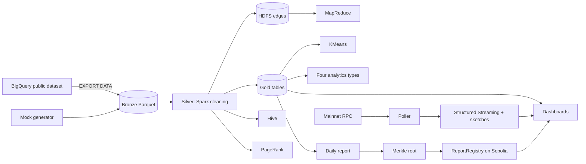

# EtherLens

Big data analytics on Ethereum, with verifiable on-chain reports.

EtherLens processes Ethereum transactions at scale in batch (Hadoop MapReduce, Spark, Hive,
MLlib) and in real time (Spark Structured Streaming with probabilistic sketches), then publishes a
Merkle root of each day's analytics report to a smart contract, so anyone can prove that a
published number belongs to the report and was not changed.

**Real run:** every Ethereum mainnet transaction from 1–31 January 2025 (37,865,791 rows,
7.02 GB Parquet) on a Google Cloud Dataproc cluster in 41 minutes; reports for 29–31 January
anchored on the Sepolia test network at
[`0x3d6707d3…1964A`](https://sepolia.etherscan.io/address/0x3d6707d3Ca4d5b7F2A39B0FD6b3B68e561E1964A).

| Result | Value |
|---|---|
| Spark vs Hadoop MapReduce (count per sender) | Spark 1.94× faster (74 s vs 144 s median) |
| MapReduce combiner | shuffle 1.75 GB → 0.94 GB (−46%) |
| Cheapest hour to transact | 04:00 UTC, 68.4% cheaper than the 15:00 UTC peak |
| Most central address (PageRank) | USDT contract, then USDC |
| Unusual addresses (KMeans) | 7,417 of 1,435,758; on mock data 29 of 29 planted anomalies found |
| HyperLogLog distinct senders (stream) | 17,712 estimated vs 17,714 exact |
| On-chain check | real report row verifies `true` on Sepolia; one changed digit gives `false` |

**See it:** open `dashboard/overview.html` in any browser (works offline): the whole project on
one page, including an in-browser Merkle verifier.

## Documentation

| Document | For |
|---|---|
| `docs/architecture.md` | How it fits together: diagram, medallion layers, batch vs streaming, the oracle problem |
| `docs/syllabus_mapping.md` | Where each course topic lives in the code, and the evidence to show |
| `docs/ml_explained.md` | KMeans and the gas prediction model from first principles |
| `docs/demo_script.md` | Two 10-minute demos (BDA, Blockchain) with fallbacks |
| `docs/viva_qa.md` | 41 likely questions with short answers |
| `docs/report_outline_bda.md`, `docs/report_outline_blockchain.md` | Report structure with the figures and numbers to use |
| `docs/PROGRESS.md` | Build log: what was built in each phase, commands, numbers, every deviation from the spec |
| `PROJECT_SPEC.md` | The original specification |

## Architecture



Details: `docs/architecture.md`.

## Repository layout

```
src/etherlens/        Python package
  mock/                 synthetic data with planted anomalies (no Spark)
  batch/                silver, gold, PageRank, KMeans, analytics, daily report (Spark)
  stream/               poller (no Spark) and Structured Streaming job
  sketches/             Count-Min, HyperLogLog, Bloom filter, reservoir sampling (no Spark)
  chain/                Merkle tree, deploy / publish / verify with web3.py (no Spark)
  config.py io_utils.py spark_session.py schemas.py
jobs/                 CLI entry points: python jobs/<name>_main.py --env local|gcp
mapreduce/            Hadoop Streaming mapper/reducer, local and Dataproc runners
hive/ sql/            HiveQL and BigQuery SQL templates
contracts/            Foundry project: ReportRegistry.sol and tests
infra/                Dataproc scripts: bootstrap, create/delete cluster, submit, poller
scripts/              figures, summary, overview page builder, benchmarks, helpers
dashboard/            Streamlit app (app.py) and the single-page overview (overview.html)
notebooks/            Jupyter notebook run on the cluster
results/ results_gcp/ outputs of the mock (local) run and the real (cloud) run
tests/                pytest suite
```

## Quick start (local, free)

Everything runs inside the project's Docker image; nothing is installed on the host.

```bash
docker compose build                                   # Python 3.11, Java 17, Spark 3.5, gcloud, Foundry
docker compose run --rm dev make check-env
docker compose up -d chain                             # local Ethereum chain (anvil) for the contract
docker compose run --rm dev make e2e-local             # mock data → whole pipeline → chain → figures → tests (~15 min)
docker compose up -d dashboard                         # Streamlit at http://localhost:8501
```

Pieces can be run one by one: `make mock`, `silver`, `gold`, `hive-local`, `mr-local`,
`spark-count`, `pagerank`, `kmeans`, `analytics`, `daily-report`, `merkle`, `chain-local`,
`figures`, `summary`, `test` (all as `docker compose run --rm dev make <target>`).

Streaming demo: `docker compose run --rm --service-ports dev bash scripts/stream_local.sh mock`
(or `replay`, or `live` with `ETH_RPC_URL` set), then the Live tab of the dashboard.

Rebuild the overview page after new results: `docker compose run --rm dev python scripts/build_overview.py`.

## Cloud run (Google Cloud Dataproc)

Needs a Google Cloud project with billing (free-trial credits are enough) and these values in
`.env`: `GCP_PROJECT`, `GCS_BUCKET`, optionally `MASTER_TYPE`, `WORKER_TYPE`, `NUM_WORKERS`,
`SPARK_PROPS` (see `.env.example`). Commands below run from the host; scripts run inside the
container.

```bash
# 1. Log in once (credentials stay in the gcloud-config Docker volume)
docker compose run --rm dev gcloud auth login --no-launch-browser
#    (or copy an existing host login: docker run --rm -v "$HOME/.config/gcloud:/src:ro" \
#     -v project_gcloud-config:/dst alpine sh -c 'cp -a /src/. /dst/')

# 2. Enable APIs, create the bucket, upload code
docker compose run --rm dev bash infra/gcp_bootstrap.sh
docker compose run --rm dev bash infra/upload_code.sh

# 3. Real data: check the range, dry-run (shows bytes, free), then export to the bucket
docker compose run --rm dev bash -c 'python scripts/render_template.py sql/check_range.sql | bq query --use_legacy_sql=false --location=US'
docker compose run --rm dev make gcp-estimate
docker compose run --rm dev make gcp-export

# 4. Cluster and the whole batch chain (billable while the cluster exists)
docker compose run --rm dev bash infra/create_cluster.sh
docker compose run --rm dev make gcp-batch             # silver → gold → Hive → MapReduce → Spark count → PageRank → KMeans → analytics → daily report
docker compose run --rm dev make gcp-bench             # optional: MapReduce vs Spark, 3 runs each

# 5. Streaming on the cluster (optional)
docker compose run --rm dev bash infra/start_poller.sh mock
docker compose run --rm dev bash infra/submit.sh stream --env gcp --bucket <bucket> --max-minutes 6
docker compose run --rm dev bash infra/stop_poller.sh

# 6. Always delete the cluster when done
docker compose run --rm dev bash infra/delete_cluster.sh
```

Then pull results and build the local outputs (exact commands in `docs/PROGRESS.md`, Phase 8,
"Pull and local post-processing"): results to `results_gcp/`, small gold tables to
`data_gcp/gold/`, Merkle trees with `python -m etherlens.chain.merkle build --all --gold
data_gcp/gold --results results_gcp`, then `make_figures.py` and `make_summary.py` with the same
folders.

## Sepolia (public test network)

Put a dev-only wallet key (`DEPLOYER_PRIVATE_KEY`), a **Sepolia** RPC URL (`SEPOLIA_RPC_URL`)
and about 0.05 free SepoliaETH on that address. Never use a wallet that holds real funds.

```bash
docker compose run --rm dev make sepolia-check         # chain id must be 11155111; shows address and balance
docker compose run --rm dev make sepolia-deploy
docker compose run --rm dev make sepolia-publish       # last 3 real days
docker compose run --rm dev make sepolia-verify DT=2025-01-31 IDX=2958
docker compose run --rm dev make sepolia-verify DT=2025-01-31 IDX=2958 TAMPER=--tamper
```

Links to the contract and transactions: `results_gcp/chain/sepolia_links.md`.

## Dashboards

- `dashboard/overview.html`: the project on one page (pipeline, results, charts with table
  views, in-browser Merkle verifier). Static; opens offline.
- Streamlit (`dashboard/app.py`, `docker compose up -d dashboard`): interactive, reads the result
  files; the Live tab follows the stream; the Blockchain tab calls `verifyRow` on the selected
  chain. Sidebar: data source `local` (mock) or `gcp` (real data pulled to `results_gcp/`).

## Troubleshooting

| Symptom | Cause and fix |
|---|---|
| Scripts fail with `$'\r': command not found` | Windows line endings. `.gitattributes` forces LF; re-checkout or run `dos2unix`. |
| `sepolia-check` shows chain id 1 or balance 0 | `SEPOLIA_RPC_URL` points at mainnet. Use the Sepolia endpoint (Alchemy: `eth-sepolia.g.alchemy.com`). The tools refuse to run otherwise. |
| Dataproc init action fails with "Network is unreachable" | Image 2.2 gives nodes internal IPs only; `create_cluster.sh` adds `--public-ip-address`. |
| Executors lost with "Container killed on request. Exit code is 143" | The node ran out of memory (Dataproc's `earlyoom`). Use bigger workers or leave headroom via `SPARK_PROPS` in `.env`. |
| Component Gateway links give HTTP 502 at `/_signin` | Browser signed in with another Google account. Use a window signed in only as the project's account, or the SSH tunnel in `docs/PROGRESS.md` (Phase 8, screenshots). |
| `gcloud compute ssh` says permission denied for `root` | GCE refuses root logins; the scripts use the `etherlens@` user. |
| Hadoop Streaming: "output directory already exists" | `run_dataproc.sh` deletes it first over SSH; re-run the script. |
| `forge build` cannot download solc | The image ships solc 0.8.24 in `/root/.svm`; rebuild the image if it is old. |
| Local Spark runs out of memory | Raise Docker's memory limit (Docker Desktop settings, or `.wslconfig` on Windows). |
| Dashboard `gcp` source shows nothing | Pull the cloud results first (`results_gcp/`, `data_gcp/gold/`). |

## Cost and safety

- BigQuery: always dry-run first (`make gcp-estimate`); a month scans about 10 GB, inside the free
  1 TB per month.
- Dataproc: about $1.1/hour for the real-data shape; `--max-idle=1h`; delete the cluster after
  each session. The whole project used about $4 of free-trial credits.
- Secrets live only in `.env` (git-ignored). Never commit it, never print keys.
- Sepolia ether is free test money; never buy crypto or use a mainnet wallet.
