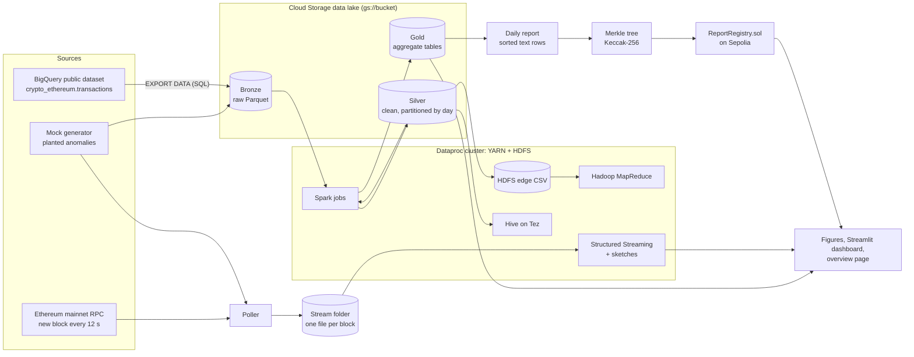

# EtherLens architecture

EtherLens takes Ethereum transactions, analyses them at scale in batch and in real time, and
publishes a cryptographic fingerprint (a Merkle root) of each day's analytics report to a smart
contract. Anyone can later prove that a published number is part of that report and was not
changed.

The real run processed **every Ethereum mainnet transaction from 1–31 January 2025**
(37,865,791 transactions, 7.02 GB of Parquet) on a Google Cloud Dataproc cluster, and anchored
three days of reports on the Sepolia test network.

## 1. The picture

## 2. Where each part runs

| Place | What runs there | Why |
|---|---|---|
| Laptop, inside the `etherlens-dev` Docker image | Mock data generator, the whole pipeline on Spark in local mode, tests, Merkle tree building, a local blockchain (`anvil`), figures, dashboards | Everything can be built and tested for free first, against data with known answers |
| Google BigQuery | One `EXPORT DATA` query that copies a month of transactions to Cloud Storage | The public dataset already holds every Ethereum transaction; the first 1 TB scanned per month is free (we scanned 9.93 GB) |
| Google Cloud Storage bucket | The data lake: bronze, silver, gold, results, code | Survives the cluster; clusters are deleted after each session |
| Google Cloud Dataproc cluster | YARN, HDFS, Spark 3.5, Hadoop MapReduce, Hive on Tez, Jupyter | A real multi-node Hadoop/Spark cluster for the course topics |
| Sepolia test network | The `ReportRegistry` contract holding daily Merkle roots | A public, free blockchain anyone can inspect on Etherscan |

## 3. Medallion layers (bronze, silver, gold)

| Layer | What it holds (real run) | Rule |
|---|---|---|
| **Bronze** `gs://…/bronze/tx` | 117 Parquet files, 7.02 GB, 37,865,791 rows exactly as exported | Never edited. Every later layer can be rebuilt from it. |
| **Silver** `gs://…/silver/tx/dt=YYYY-MM-DD/` | 37,323,780 rows: typed, deduplicated by hash, failed transactions removed, values converted (wei → ETH, wei → gwei), one Parquet file per day | Partitioned by day so a query for one day reads one file (partition pruning) |
| **Gold** `gs://…/gold/<table>` | Small query-ready tables: `daily_stats` (31 rows), `hourly_gas` (744), `hour_of_day_profile` (24), `top_senders`, `whales`, `address_features` (1,435,758 addresses), plus `pagerank`, `address_clusters`, `flagged_addresses`, `daily_report` | What dashboards, ML and reports read |

**Data lake vs warehouse.** The bucket is a *data lake*: raw files in an open format, with the
schema applied when reading (Hive's external tables are *schema-on-read* over the same Parquet
files). The gold tables play the *warehouse* role: cleaned, aggregated, ready to query.

**The V's of big data, in this project**

| V | Here |
|---|---|
| Volume | 37.9 M transactions, 7 GB compressed for one month (the full dataset is billions of rows) |
| Velocity | A new Ethereum block every 12 s with 170–400 transactions (measured: 10 live blocks, exactly 12.0 s apart) |
| Variety | Columnar Parquet (batch), JSON-lines files (stream), on-chain contract state |
| Veracity | Duplicates, malformed rows and failed transactions are counted (with Spark accumulators) and removed in silver |
| Value | When to send a transaction (cheapest hour 04:00 UTC, 68% below peak), unusual addresses, verifiable reports |

## 4. Batch pipeline

Every Spark job is a CLI script (`jobs/<name>_main.py --env local|gcp`). On the cluster,
`scripts/run_gcp_batch.sh` submits them in order and records each job's time.

| Step | Code | In → out | Main technique | Real-run time |
|---|---|---|---|---|
| Export | `sql/export_bronze.sql` | BigQuery → bronze | `EXPORT DATA` with partition-pruned date filter | 7 s in BigQuery |
| Silver | `src/etherlens/batch/silver.py` | bronze → silver + HDFS edge CSV | DataFrame casts, accumulators inside an action, `dropDuplicates`, `persist`, `repartition("dt")` | 5 min 40 s |
| Gold | `batch/gold_aggregates.py` | silver → gold tables | `groupBy` aggregations, `countDistinct`, `percentile_approx`, join | 4 min 45 s |
| Hive | `hive/*.hql` | silver, gold → query results | External partitioned table, `MSCK REPAIR`, five HiveQL queries on Tez | 9 min 26 s |
| MapReduce | `mapreduce/mapper.py`, `reducer.py` | HDFS edges → sender counts | Hadoop Streaming, with and without combiner | 5 min 50 s (both) |
| Spark count | `batch/count_per_sender_spark.py` | HDFS edges → sender counts | RDD `map` → `reduceByKey` | 1 min 27 s |
| PageRank | `batch/pagerank.py` | last 7 days of silver → ranks | Pair RDDs, `groupByKey`, `join`, `cache`, `checkpoint` | 2 min 22 s |
| KMeans | `batch/kmeans_anomaly.py` | `address_features` → clusters, flags | MLlib pipeline, silhouette, PCA, distance UDF | 5 min 1 s |
| Analytics | `batch/analytics_types.py` | gold → four analytics types | Correlation, linear regression, chronological split | 1 min 20 s |
| Daily report | `batch/daily_report.py` | silver, gold → one text report per day | Partition-pruned per-day reads, broadcast join, deterministic sort | 4 min 23 s |
| Merkle | `src/etherlens/chain/merkle.py` | report → root + proofs | Keccak-256 Merkle tree (runs on the laptop) | seconds |

The whole chain took **41 minutes** on 1 × e2-standard-4 master + 4 × e2-highmem-4 workers
(20 vCPUs).

## 5. Streaming pipeline

1. **Poller** (`stream/poller.py`, no Spark) writes one JSON-lines file per block into a folder,
   atomically (temporary name, then rename on a laptop; GCS objects appear atomically).
   Modes: `mock` (synthetic blocks), `replay` (a past day of silver), `live` (mainnet RPC).
2. **Structured Streaming** (`stream/stream_job.py`) reads that folder as a file source:
   - Q1: 1-minute **tumbling** windows (tx count, average gas, distinct senders with
     `approx_count_distinct`, ETH moved, plain-transfer share), with a 2-minute watermark.
   - Q2: 5-minute **sliding** windows moving every minute.
   - Q3: raw rows into `foreachBatch`, which updates four sketches in driver memory:
     Count-Min (heavy hitters), HyperLogLog (distinct senders), Bloom filter (flagged
     addresses from KMeans) and a reservoir sample.
   - Alerts: a window whose volume or gas is more than 3 standard deviations from the last 30
     windows, and any transaction touching a Bloom-filter address.
3. Outputs are small JSON files (`latest_tumbling.json`, `latest_sliding.json`,
   `alerts.json`, `sketch_metrics.json`) read by the dashboard's Live tab.

Checkpoints go to HDFS on the cluster (many small writes per micro-batch are slow on Cloud
Storage). Sketch state lives in driver memory, so a restart resets the sketches: this is a
known, documented limit.

**Reorgs.** Ethereum can occasionally replace the most recent block. The live poller starts two
blocks behind the head, which avoids most short reorgs; a deeper reorg would leave an orphaned
block's transactions in the stream. For per-minute statistics that is a small, accepted error.

## 6. Blockchain layer and the oracle problem

A smart contract cannot read off-chain data or run analytics over millions of rows. Something
outside the chain, an *oracle*, has to publish the results. EtherLens acts as that publisher, and
the design makes the publisher's claims checkable:

1. Each day's report is a set of plain text rows such as
   `2025-01-31|summary|tx_count|1172912`, sorted so the same data always gives the same rows.
2. Each row is hashed with Keccak-256 (Ethereum's hash). Pairs of hashes are combined
   (smaller first) up to a single 32-byte **Merkle root**.
3. `ReportRegistry.publishRoot(day, root, leafCount, uri)` stores the root on-chain.
   The contract is owner-only and append-only: publishing the same day twice reverts with
   `AlreadyPublished`, so a root can never be silently replaced.
4. Anyone with a row and its proof (about 12 sibling hashes for 3,000 rows) can call
   `verifyRow(day, row, proof)`, a free read-only call, which recomputes the root and compares
   it with the stored one. Changing one character of the row gives a different root, so the
   check fails.

**What this guarantees.** *Integrity*: a published report cannot be altered later without
detection, and any single number can be proved part of it without revealing the whole report.
**What it does not guarantee.** *Correctness*: the publisher could have computed a wrong number
before publishing. That is the oracle problem. Here it is reduced because the source data is
public: anyone can rerun the pipeline on the same BigQuery data and compare roots, and the daily
report is deterministic for exactly that reason.

**Why only the root.** Storing one 32-byte value costs the same gas for 10 rows or 1,000,000 rows
(measured on a local chain: about 105,000 gas for 1,000 to 1,000,000 rows; on Sepolia about
378,000 gas per day after the first). Storing the rows themselves would cost gas in proportion
to their size.

**Why a test network.** Sepolia behaves like mainnet (same contract code, same tools, public
explorer) but its ether is free from faucets, so the project costs nothing.

## 7. Cluster configuration

| Setting | Value | Reason |
|---|---|---|
| Image | Dataproc 2.2 (Debian 12, Spark 3.5, Hadoop 3.3, Hive 3.1) | Current, supported |
| Shape (real data) | 1 × e2-standard-4 master + 4 × e2-highmem-4 workers | The spec's 2 × e2-standard-2 workers ran out of memory on 38 M rows |
| Executors | 2 per worker, 2 cores, 9 GB heap + 3 GB overhead | Leaves ~8 GB per node for the OS and off-heap memory (Dataproc's `earlyoom` killed executors when nodes were packed full) |
| Disks | 50 GB `pd-balanced` | `pd-standard` at 50 GB is too slow for shuffles |
| Network | Public IPs on nodes | Image 2.2 defaults to internal IPs only, which blocked the init action and SSH |
| Safety | `--max-idle=1h`, cluster deleted after every session | Credits are only spent while work runs |

## 8. Design decisions worth knowing

- **One file per day in silver** (`repartition("dt")`): 200 small files per day made every
  later job slow, because each file costs a rename on Cloud Storage and an open in every reader.
  Silver went from 888 s to 194 s on the mock data.
- **Cache what is reused** (`persist` after deduplication in silver, the clustered table in
  KMeans): without it Spark recomputes the expensive shuffle for every action.
- **Coalesce the edge CSV to 32 files** so MapReduce runs ~32 map tasks of about one HDFS block
  each, instead of 200 tiny ones.
- **Deterministic reports**: ties in "top 50 senders" are broken by address, so the same data
  always produces the same rows and the same Merkle root.
- **Merkle trees are built on the laptop**: the cluster has no `eth_utils`, and the reports are
  small (about 3,000 rows a day).
- **All result files go through one I/O helper** (`src/etherlens/io_utils.py`) that writes to
  local disk, `gs://` or `hdfs://` the same way.

Every deviation from the original specification, with its reason, is listed in
`docs/PROGRESS.md`.
